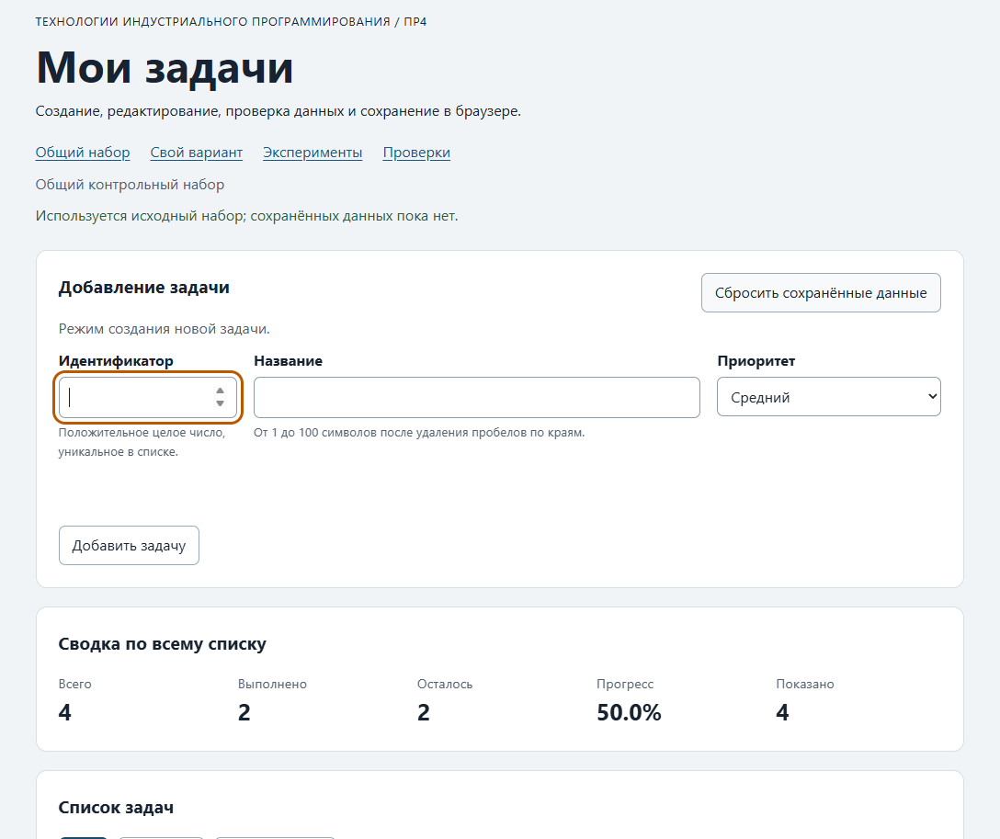
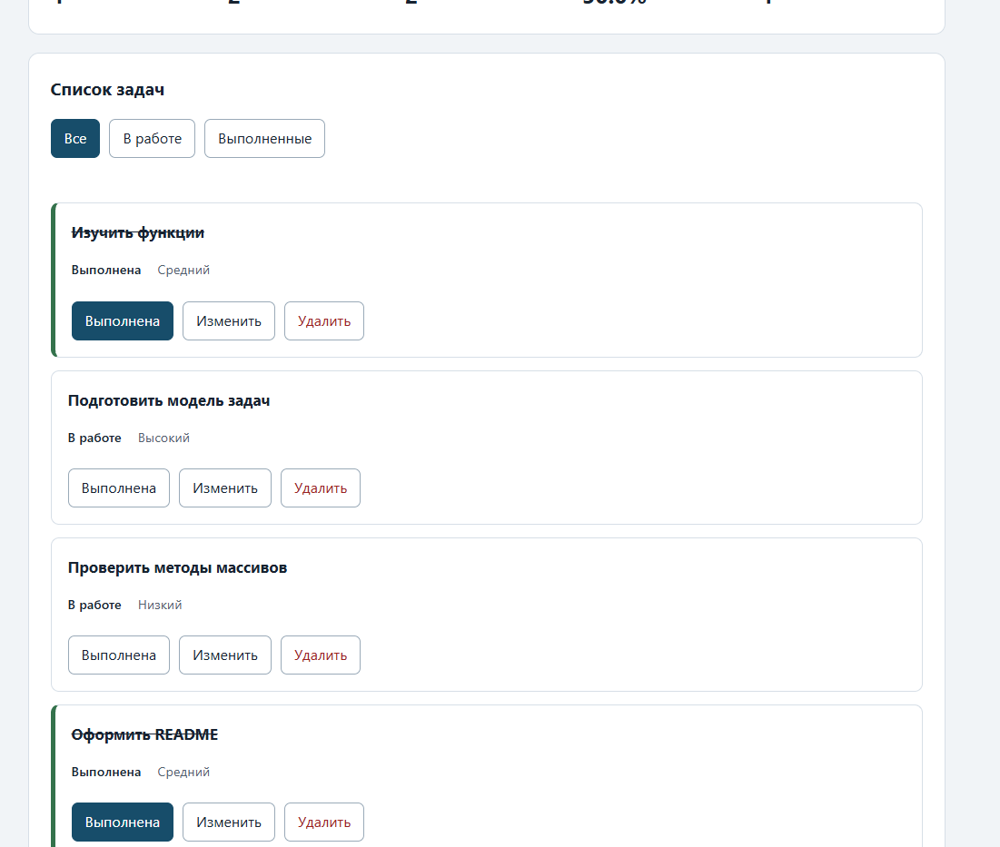

# Практическая работа № 4

**Тема:** Формы, валидация и локальное хранение данных

## Данные работы

| Поле | Значение |
|---|---|
| Имя | Виктория Сутормина |
| Группа | ЭФБО-06-25 |
| Вариант | 3 |
| Тематика | Создание сайта-портфолио |
| Node.js | v24.22.0 |
| npm | 11.19.1 |
| Git | 2.56.0.windows.3 |
| Браузер | Chrome 156.0.8078.47, 64 бит |
| Операционная система | Windows |

## Цель работы

Освоить обработку HTML-форм, нативную и прикладную валидацию, создание и редактирование задач, сохранение и восстановление состояния с помощью `localStorage`.

## Запуск

Команды выполняются из папки `practice-04`.

```powershell
npm.cmd start
```

Устанавливать зависимости через `npm install` не требуется.

Адреса приложения:

```text
http://127.0.0.1:5504/
http://127.0.0.1:5504/index.html?dataset=variant
http://127.0.0.1:5504/examples/forms-storage.html
http://127.0.0.1:5504/checks.html
```

Команды проверки:

```powershell
npm.cmd run check:service
npm.cmd run check:modules
```

Обе группы модульных проверок можно запустить вместе:

```powershell
npm.cmd test
```

Дополнительные проверки:

```powershell
node checks/update-task.checks.js
node checks/form-validation.checks.js
```

## Перенос результата ПР3

В существующий проект добавлена папка `practice-04` из стартового комплекта. В неё перенесены собственные реализации четырёх модулей из ПР3.

| Файл | Что перенесено или изменено |
|---|---|
| `data.js` | Общий набор без изменений и шесть задач индивидуального варианта № 3. |
| `task-service.js` | Ранее реализованные функции работы с задачами; затем добавлена `updateTask`. |
| `task-selectors.js` | Фильтры `all`, `pending`, `completed`. |
| `task-view.js` | Функции отображения. Добавлена кнопка `type="button"` с `data-action="edit"` и вложенным `span.action-label` с текстом «Изменить». |

Использована новая заготовка `main.js` из стартового комплекта ПР4. Она дополнена отрисовкой, обработчиками формы, действий карточек, фильтров и сброса.

После переноса сервис прошёл 35 регрессионных проверок без ошибок.

### Обновление задачи

Функция `updateTask(tasks, id, title, priority)` проверяет идентификатор, наличие задачи, название и приоритет. Для нормализации названия переиспользуется `createTask`.

При успехе возвращается новый массив. В выбранной задаче изменяются только `title` и `priority`. Поля `id`, `completed`, порядок задач и исходные данные сохраняются.

При отказе возвращается `{ ok: false, error }`.

Дополнительные проверки в `checks/update-task.checks.js` подтвердили:

- обновление невыполненной задачи;
- сохранение выполненного статуса;
- удаление краевых пробелов;
- отказ для неверного или отсутствующего id;
- проверку названия и приоритета;
- сохранность замороженных исходных данных и порядка задач.

Фактический итог:

```text
Все 6 проверок updateTask пройдены.
```

## Эксперименты с формой и хранилищем

Перед каждым экспериментом записан прогноз, затем фактический результат и объяснение.

| № | До запуска: прогноз | После запуска: результат | Объяснение |
|---:|---|---|---|
| 1. Пустое обязательное поле | Браузер заблокирует отправку, `submit` не выполнится, журнал не изменится, `validity.valid` будет `false`. | Появилось «Заполните это поле.». Журнал остался прежним. В консоли получено `false`. | Нативная проверка `required` блокирует отправку до вызова обработчика `submit`. |
| 2. Название из пробелов | `required` пропустит пробелы, но прикладная проверка отклонит пустую строку после `trim()`. | Показано «Название не должно состоять только из пробелов.». В журнале: «submit получен, но прикладная проверка отклонила значение.». | `required` допускает непустую строку из пробелов. Прикладная проверка использует `trim()`, `setCustomValidity()` и `reportValidity()`. |
| 3. Типы значений `FormData` | Значения полей будут строками; `defaultPrevented` станет `true`; название нормализуется, объект сохранится как JSON. | Получены `submit.defaultPrevented: true`, `typeof FormData title: string`, `typeof localStorage value: string`. Сохранены название «Изучить формы» без краевых пробелов и приоритет `medium`. | `FormData` возвращает строковые значения. `preventDefault()` отменяет стандартную отправку, `trim()` нормализует название, `JSON.stringify()` создаёт строку. |
| 4. Чтение JSON | `getItem()` вернёт строку, `JSON.parse()` восстановит объект. | Журнал показал «JSON прочитан успешно». В `raw` находится строка, в `parsed` — объект с названием «Изучить формы» и приоритетом `medium`. | `localStorage` хранит строки. Для восстановления объекта требуется разбор JSON. |
| 5. Повреждённый JSON | `JSON.parse()` выбросит исключение, которое перехватит `catch`. | При чтении `{broken-json` показано «JSON.parse завершился ошибкой» и `Expected property name or '}' in JSON at position 1 (line 1 column 2)`. | Повреждённая строка не соответствует синтаксису JSON. Исключение перехвачено, страница продолжила работать. |

Нативная проверка, прикладная валидация и обработка ошибок JSON решают разные задачи и дополняют друг друга.

## Организация кода

### Распределение ответственности

| Модуль | Ответственность |
|---|---|
| `data.js` | Исходные общий и индивидуальный наборы. |
| `task-service.js` | Создание, поиск, статистика и операции над задачами без изменения исходных данных. |
| `task-selectors.js` | Получение видимой выборки по фильтру. |
| `task-view.js` | Карточки, список, сводка и пустые состояния. Названия выводятся через `textContent`. |
| `form-validation.js` | Чистая проверка и нормализация черновика формы. |
| `task-storage.js` | Проверка схемы, JSON, чтение, запись и удаление данных с обработкой исключений. |
| `main.js` | Текущее состояние, режимы формы, события и согласование остальных модулей. |

### Валидация формы

Функция `validateTaskDraft(draft, tasks, editingId = null)` проверяет данные независимо от DOM.

При создании идентификатор преобразуется в число и проверяется на положительное безопасное целое значение и уникальность.

При редактировании используется `editingId`, а значение `draft.id` игнорируется. Редактируемая задача должна существовать. Совпадение идентификатора с самой задачей не считается дубликатом.

Название должно быть строкой. После `trim()` его длина должна составлять от 1 до 100 символов. Допустимые приоритеты: `low`, `medium`, `high`.

Успех:

```js
{ ok: true, value: { id, title, priority } }
```

Отказ:

```js
{ ok: false, errors }
```

Объект `errors` содержит только поля с ошибками. Независимые ошибки возвращаются вместе.

Функция не изменяет черновик и список задач. Дополнительные проверки подтвердили нормализацию, границы полей, режим редактирования, возврат нескольких ошибок и неизменность входных данных.

Фактический итог:

```text
Все 8 проверок validateTaskDraft пройдены.
```

### Режимы формы и обработка событий

Форма обрабатывается через событие `submit` с вызовом `preventDefault()`. Значения получаются через `FormData`.

В режиме создания поле id доступно, кнопка отмены скрыта. При редактировании поля заполняются из выбранной задачи, id блокируется, появляется кнопка отмены, фокус переводится в название.

Отключённое поле id отсутствует в `FormData`, поэтому при редактировании используется `editingId`.

После успешной операции форма очищается и возвращается в режим создания. При отмене несохранённые изменения не применяются.

Ошибки связываются с полями через сообщения, `setCustomValidity()` и `aria-invalid`. При событии `input` очищается ошибка только соответствующего поля.

### Локальное хранение

Состояние сохраняется в оболочке:

```json
{
  "version": 1,
  "tasks": []
}
```

Проверяются версия, массив задач, уникальные положительные безопасные целочисленные id, нормализованные названия длиной от 1 до 100 символов, логический статус и допустимый приоритет.

Успешный `JSON.parse()` подтверждает только синтаксис JSON. Поэтому схема проверяется до использования данных. Некорректная запись отклоняется целиком без автоматического исправления или удаления.

Результат загрузки различает:

- `initial` — записи нет, возвращается независимая копия исходного набора;
- `storage` — корректная запись восстановлена;
- `fallback` — произошла ошибка чтения, JSON, версии или схемы, возвращены исходные данные и сообщение.

Объект `storage` передаётся аргументом. Это явно обозначает зависимость от среды и позволяет использовать имитацию хранилища в проверках.

Общий и индивидуальный наборы используют разные ключи. Автоматические браузерные проверки работают с отдельными ключами.

### Интеграция действий

Обработчик карточек использует делегирование событий и распознаёт `toggle`, `edit`, `delete`.

Начало редактирования только заполняет форму. После успешных добавления, редактирования, изменения статуса и удаления новое состояние сохраняется.

Фильтрация меняет только отображение. `renderApp` не читает и не записывает хранилище.

После переключения статуса и удаления вызывается `restoreTaskFocus`. Фокус возвращается на действие той же задачи либо на активный фильтр.

Сброс удаляет только текущий ключ, восстанавливает независимую копию исходного набора, фильтр «Все» и режим создания. Исходный набор сразу после сброса обратно не сохраняется.

Ошибки доступа и записи показываются пользователю. При невозможности сохранения успешное изменение остаётся в памяти текущей вкладки.

## Проверка формы

| Сценарий | Ожидаемый результат | Фактический результат | Итог |
|---|---|---|---|
| Добавление корректной задачи | Добавление, очистка формы и сохранение | После добавления задачи сводка: 5 / 2 / 3 / 40.0%. Форма очистилась, показано сообщение о сохранении. | Пройдено |
| Повторяющийся id | Отказ без изменения списка | Для ID 4 показано «Задача с таким ID уже существует». Сводка осталась 5 / 2 / 3 / 40.0%. | Пройдено |
| Пустое название | Отказ | Показано «Заполните это поле.». Сводка осталась 5 / 2 / 3 / 40.0%. | Пройдено |
| Название из пробелов | Отказ прикладной проверки | Показано «Название должно содержать от 1 до 100 символов». Сводка не изменилась. | Пройдено |
| Название длиной 100 | Успех | Задача 30 добавлена, форма очистилась. Сводка: 6 / 2 / 4 / 33.3%. | Пройдено |
| Название длиной 101 | Отказ | После программной установки длинного значения добавление отклонено. Сводка осталась 6 / 2 / 4 / 33.3%. | Пройдено |
| Редактирование title и priority | Меняется одна задача, статус сохраняется | У задачи 1 установлены название «Изучить функции и формы» и приоритет `high`. Статус остался «Выполнена». Сводка: 6 / 2 / 4 / 33.3%. | Пройдено |
| Отмена редактирования | Возврат в режим создания | Форма очистилась, id стал доступным, кнопка отмены скрылась. Несохранённые изменения не применены. | Пройдено |

В сводках значения указаны в порядке: всего / выполнено / осталось / прогресс.

## Общий сценарий

| Шаг | Действие | Видимые id | Всего | Выполнено | Осталось | Прогресс | Состояние storage |
|---:|---|---|---:|---:|---:|---:|---|
| 0 | Исходный запуск после сброса | `[1, 4, 7, 10]` | 4 | 2 | 2 | 50.0% | Текущий ключ удалён, используется исходный набор |
| 1 | Добавление `20`: «Изучить localStorage», `high` | `[1, 4, 7, 10, 20]` | 5 | 2 | 3 | 40.0% | Сохранён список из пяти задач |
| 2 | Отказ для повторного `id = 4` | `[1, 4, 7, 10, 20]` | 5 | 2 | 3 | 40.0% | Ошибка валидации, дополнительная запись не выполняется |
| 3 | Редактирование `4`: «Подготовить форму задач», `low` | `[1, 4, 7, 10, 20]` | 5 | 2 | 3 | 40.0% | Изменения сохранены, статус остался `false` |
| 4 | Переключение `7` в выполненное состояние | `[1, 4, 7, 10, 20]` | 5 | 3 | 2 | 60.0% | Сохранён новый статус |
| 5 | Удаление `1` | `[4, 7, 10, 20]` | 4 | 2 | 2 | 50.0% | Сохранён список без задачи 1 |
| 6 | Перезагрузка | `[4, 7, 10, 20]` | 4 | 2 | 2 | 50.0% | Список восстановлен, показано сообщение о восстановлении |
| 7 | Сброс | `[1, 4, 7, 10]` | 4 | 2 | 2 | 50.0% | Текущий ключ удалён, исходный набор повторно не записывается |

## Проверка восстановления и ошибок

| Случай | Ожидание | Фактический результат | Итог |
|---|---|---|---|
| Записи нет | Независимая копия исходного набора | Модульные проверки № 16 и № 27 подтвердили независимость копии. Браузерная проверка начального запуска пройдена. | Пройдено |
| Корректная запись | Восстановление после перезагрузки | Модульная проверка № 17 и браузерный сценарий восстановления пройдены. | Пройдено |
| Повреждённый JSON | Исходный набор и предупреждение | В рабочий ключ записана строка `{broken-json`. После перезагрузки показано предупреждение и восстановлена сводка 4 / 2 / 2 / 50.0%. | Пройдено |
| Неверная версия или схема | Исходный набор и предупреждение | Модульные проверки № 19 и № 20, а также браузерная проверка некорректной схемы пройдены. | Пройдено |
| Сброс | Удаление текущего ключа | После ручного сброса `getItem()` вернул `null`, предупреждение исчезло. Модульная проверка № 25 подтвердила сохранность другого ключа. | Пройдено |
| Разделение наборов | Изменения не смешиваются | Пройдена браузерная проверка разных ключей. При ручной проверке варианта общий набор не изменился. | Пройдено |

До сброса повреждённая запись сохранялась: `getItem("tip-js-practice-04:demo")` возвращал `{broken-json`. После сброса возвращался `null`.

Перехват исключений чтения, записи и удаления подтверждён модульными проверками № 21, № 24 и № 26.

## Индивидуальный вариант

Вариант № 3 — «Создание сайта-портфолио».

| ID | Исходное название | Выполнена | Приоритет |
|---:|---|---|---|
| 11 | Собрать примеры работ | Да | high |
| 23 | Выбрать цветовой профиль | Да | medium |
| 37 | Сверстать главную страницу | Нет | high |
| 41 | Настроить отправку формы | Нет | medium |
| 58 | Зарегистрировать домен | Нет | low |
| 64 | Опубликовать сайт на хостинге | Нет | high |

Перед проверкой выполнен сброс.

Добавлена задача 75 «Добавить раздел отзывов в портфолио» с приоритетом `medium`. У задачи 23 установлены название «Обновить цветовую схему портфолио» и приоритет `high`. Выполненный статус сохранился. Затем удалена задача 37.

| Этап | Всего | Выполнено | Осталось | Прогресс | Видимые id |
|---|---:|---:|---:|---:|---|
| Исходный набор | 6 | 2 | 4 | 33.3% | `[11, 23, 37, 41, 58, 64]` |
| Добавление `75` | 7 | 2 | 5 | 28.6% | `[11, 23, 37, 41, 58, 64, 75]` |
| Редактирование `23` | 7 | 2 | 5 | 28.6% | `[11, 23, 37, 41, 58, 64, 75]` |
| Удаление `37` | 6 | 2 | 4 | 33.3% | `[11, 23, 41, 58, 64, 75]` |
| Перезагрузка | 6 | 2 | 4 | 33.3% | `[11, 23, 41, 58, 64, 75]` |
| Сброс | 6 | 2 | 4 | 33.3% | `[11, 23, 37, 41, 58, 64]` |

После перезагрузки изменения сохранились. Общий набор от действий в варианте не изменился.

После сброса восстановились исходные задачи, название и приоритет задачи 23. Задача 75 исчезла, задача 37 восстановилась.

Итоговый прогресс после добавления и удаления — 33.3%, что соответствует варианту № 3.

## Протокол проверок сервиса

Команда:

```powershell
npm.cmd run check:service
```

Фактический вывод:

```text
OK: 01. Создание задачи с явным приоритетом
OK: 02. Приоритет по умолчанию
OK: 03. Удаление краевых пробелов без изменения внутренних
OK: 04. Граничные длины названия и положительный безопасный id
OK: 05. Некорректные названия при создании
OK: 06. Некорректные идентификаторы при создании
OK: 07. Все допустимые приоритеты и отклонение недопустимых
OK: 08. Каждый вызов createTask возвращает новый объект
OK: 09. Поиск по id, а не по индексу
OK: 10. Отсутствующая задача и пустой массив при поиске
OK: 11. Поиск не преобразует строковый id в число
OK: 12. Получение невыполненных задач
OK: 13. Пустой список, все выполнены и все не выполнены
OK: 14. Названия в исходном порядке и пустой список
OK: 15. Сводка по общему набору
OK: 16. Сводка по пустому списку
OK: 17. Сводка: ничего не выполнено и выполнено всё
OK: 18. Процент остаётся числом без предварительного округления
OK: 19. Добавление в конец без изменения входного массива
OK: 20. Добавление в пустой список с приоритетом по умолчанию
OK: 21. Повторяющийся id отклоняется
OK: 22. Добавление не обходит проверки createTask
OK: 23. Изменение completed в обе стороны
OK: 24. completed принимает только boolean
OK: 25. Некорректный или отсутствующий id при изменении статуса
OK: 26. Повторная установка статуса создаёт новый результат
OK: 27. Переименование сохраняет остальные поля
OK: 28. Проверки названия при переименовании
OK: 29. Некорректный или отсутствующий id при переименовании
OK: 30. Удаление по id с сохранением порядка
OK: 31. Удаление единственной записи
OK: 32. Некорректный, отсутствующий id и удаление из пустого списка
OK: 33. Входные объекты не изменяются ни одной операцией
OK: 34. Общий сценарий и все промежуточные сводки
OK: 35. Работа с другим набором, без зависимости от demoTasks

Проверок пройдено: 35; не пройдено: 0.
```

## Протокол проверок новых модулей

Команда:

```powershell
npm.cmd run check:modules
```

Фактический вывод:

```text
OK: 01. updateTask изменяет название и приоритет выбранной задачи
OK: 02. updateTask нормализует название и сохраняет completed
OK: 03. updateTask не изменяет входной массив и объекты
OK: 04. updateTask отклоняет некорректный и отсутствующий id
OK: 05. updateTask отклоняет некорректные название и приоритет
OK: 06. Валидация создания нормализует поля
OK: 07. Валидация отклоняет некорректные id
OK: 08. Валидация отклоняет повторяющийся id при создании
OK: 09. Валидация проверяет название после trim
OK: 10. Валидация принимает только три приоритета
OK: 11. В режиме редактирования используется editingId
OK: 12. Редактирование отсутствующей задачи отклоняется
OK: 13. Валидация не изменяет draft и список
OK: 14. Проверка схемы принимает корректный список
OK: 15. Проверка схемы отклоняет неверную структуру
OK: 16. Отсутствующая запись возвращает независимую копию исходных данных
OK: 17. Корректная запись восстанавливается из хранилища
OK: 18. Повреждённый JSON приводит к безопасному fallback
OK: 19. Неизвестная версия приводит к безопасному fallback
OK: 20. Некорректные задачи из JSON не принимаются
OK: 21. Ошибка getItem перехватывается
OK: 22. Сохранение записывает версию и задачи
OK: 23. Некорректный список не записывается
OK: 24. Ошибка setItem перехватывается
OK: 25. Удаляется только переданный ключ
OK: 26. Ошибка removeItem перехватывается
OK: 27. Результат загрузки не разделяет объекты с fallback

Проверок пройдено: 27; не пройдено: 0.
```

## Протокол браузерных проверок

Проверки выполнены на странице:

```text
http://127.0.0.1:5504/checks.html
```

Фактический протокол:

```text
OK: Фильтры ПР3 сохраняют порядок и не изменяют вход
OK: Карточка содержит toggle, edit и delete
OK: Название задачи выводится как текст
OK: Повторная отрисовка списка не накапливает карточки
OK: Сводка использует полный список и отдельный visibleCount
OK: Пустые состояния различают список и фильтр
OK: Приложение запускается с исходным набором
OK: Корректная форма добавляет задачу и сохраняет данные
OK: Повторяющийся id отклоняется без записи
OK: Название из пробелов отклоняется прикладной проверкой
OK: Нативные ограничения не пропускают пустую форму
OK: Кнопка edit заполняет форму и блокирует id
OK: Редактирование меняет title и priority, сохраняя completed
OK: Отмена редактирования возвращает режим создания
OK: Успешная отправка очищает ошибки и форму
OK: Изменение статуса сохраняется
OK: Удаление сохраняется
OK: Фильтр не записывается, но сохраняется после изменения данных
OK: Перезагрузка восстанавливает сохранённые задачи
OK: Сброс удаляет ключ и восстанавливает исходный набор
OK: Повреждённый JSON не ломает запуск
OK: Некорректная схема из storage заменяется исходным набором
OK: Общий и индивидуальный наборы используют разные ключи

Всего: 23. Пройдено: 23. Ошибок: 0.
```

Все автоматические проверки завершились успешно. Браузерные проверки используют отдельные ключи хранилища.

## Собственные проверки

| № | Исходное состояние и действия | Ожидаемый результат | Фактический результат | Итог |
|---:|---|---|---|---|
| 1 | Введены повторный ID 4 и название из пробелов. После появления двух ошибок исправлен только ID на 90, без отправки формы. | Обе ошибки отображаются; исправление ID очищает только его ошибку. | Показаны обе ошибки. После изменения ID его ошибка исчезла, ошибка названия осталась. | Пройдено |
| 2 | Добавлена задача 91 «Проверка перезагрузки». При редактировании введено название «Не сохранять», затем страница перезагружена без сохранения формы. | Восстановить сохранённую задачу с прежним названием и открыть пустую форму создания. | Карточка восстановилась с названием «Проверка перезагрузки». Несохранённое название не применилось, форма открылась пустой в режиме добавления. | Пройдено |
| 3 | В рабочий ключ записан корректный JSON версии 1 с двумя задачами с одинаковым ID 91. Выполнены перезагрузка и последующий сброс. | Отклонить запись целиком, показать предупреждение и исходный набор. После сброса удалить ключ. | Показано предупреждение о неверной схеме, восстановлена сводка 4 / 2 / 2 / 50.0%. После сброса предупреждение исчезло, `getItem()` вернул `null`. | Пройдено |

## Отладка и клавиатура

### Исправленные проблемы

При подготовке окружения PowerShell не распознавал `node` и `npm`. После установки Node.js 24 и повторного открытия WebStorm стали доступны Node.js `v24.22.0` и npm `11.19.1`.

При запуске проверки валидации возникла ошибка `MODULE_NOT_FOUND`. Проверены текущая папка и расположение файла. Обнаружено имя `orm-validation.checks.js` вместо `form-validation.checks.js`. После исправления имени и запуска из `practice-04` все восемь проверок прошли.

### Отладка обработчика формы

В DevTools установлена точка останова внутри `handleFormSubmit`. Прослежены успешное добавление и отказ при повторяющемся идентификаторе.

| Этап | Наблюдение |
|---|---|
| Сырой `draft` | Обычные значения из `FormData` представлены строками; название содержит введённые краевые пробелы. |
| Результат `validateTaskDraft` | Для корректных данных получено `ok: true`; id преобразован в число, название очищено через `trim()`. |
| Результат сервисной операции | Получено `ok: true` и новый массив задач с добавленной записью. |
| Сохранённое значение | В `localStorage` записана строка JSON с оболочкой `version: 1` и массивом `tasks`. |
| Повторяющийся ID | Валидация возвращает `ok: false` и ошибку поля id. Выполнение переходит в ветку показа ошибок; сервисная операция и сохранение не вызываются. |

Отладка подтвердила последовательность обработки: чтение формы, валидация, сервисная операция, обновление состояния, сохранение и отрисовка.

### Проверка клавиатуры

Проверено управление клавиатурой:

- Enter в поле названия отправляет форму и добавляет задачу;
- Tab перемещает фокус между элементами;
- Space активирует кнопку «Изменить»;
- при начале редактирования фокус устанавливается в название, id блокируется;
- отмена через Enter возвращает пустую форму создания и фокус в поле id.

## Вид приложения

Фактические скриншоты общего набора после запуска:





## Дополнительное задание

Не выполнено.

## Вывод

Реализовано браузерное приложение для создания и редактирования задач с нативной и прикладной валидацией. Интерфейс поддерживает фильтрацию, изменение статуса, удаление и отмену редактирования.

Состояние сохраняется в `localStorage` и восстанавливается после перезагрузки. Проверка версии и схемы предотвращает использование некорректных данных. Ошибки хранения обрабатываются отдельно от изменения модели, а сброс удаляет только ключ текущего набора.

Пройдены все автоматические проверки: 35 проверок сервиса, 27 проверок новых модулей и 23 браузерных сценария. Дополнительно пройдены шесть проверок `updateTask` и восемь проверок `validateTaskDraft`.

Выполнены пять экспериментов с формой и JSON, проверки формы, общий и индивидуальный сценарии, три собственные проверки, ручная проверка повреждённого JSON и его удаления сбросом. Проведены отладка обработчика формы и проверка управления клавиатурой.

HTML-ограничения выполняют первичную проверку, прикладная валидация проверяет правила модели, а проверка JSON и схемы защищает загрузку сохранённого состояния. Разделение этих обязанностей позволяет независимо проверять модель, интерфейс и хранение данных.