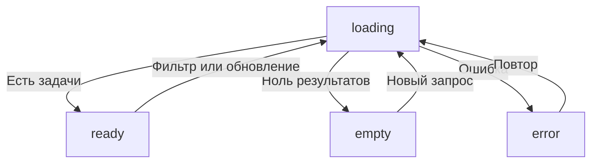

# Отчёт по практической работе № 6

**Тема:** Подключение браузерного приложения к API<br>
**Автор:** Виктория Сутормина<br>
**Группа:** ЭФБО-06-25<br>
**Вариант:** 3<br>
**Дата:** 27.10.2026

## 1. Цель и результат

Цель работы — подключить интерфейс задач к HTTP API, освоить GET, POST, PATCH и DELETE, валидацию, обработку ошибок и управление асинхронным состоянием.

Реализовано приложение, которое получает категории и задачи с сервера, передаёт фильтры как query-параметры, создаёт, редактирует, завершает и удаляет задачи. После изменения выполняется повторный GET с текущими фильтрами. Реализованы `loading`, `ready`, `empty`, `error`, повтор загрузки, reset, блокировка повторных мутаций и защита от устаревшего ответа.

Из ПР5 перенесены общий HTTP-клиент, проверка схемы, классификация ошибок, тайм-аут, внешняя отмена и параллельная загрузка. Сохранён вариант №3. Задачи принадлежат серверу; `localStorage` не используется как источник или хранилище задач.

Выполнено дополнительное задание №5: показ длительности последней загрузки через `performance.now()`.

## 2. Окружение и запуск

### 2.1. Окружение подготовки и локальная проверка

| Инструмент | Версия |
|---|---|
| Node.js | v24.22.1, ветка 24 LTS |
| npm | 11.9.0 |
| Git | 2.51.1 |
| ОС автоматических проверок | Linux, x86_64 |
| Дополнительная среда проверки DOM | Happy DOM 21.0.4 |

В таблице указана среда подготовки протоколов из папки `reports`. Затем выполнен локальный прогон в Windows (PowerShell): 70 основных проверок, 14 собственных и 14 браузерных — без ошибок. Локальные результаты подтверждены выводом команд и снимками экрана. Версии Node.js, npm и Git локального прогона отдельно не зафиксированы.

Приложение не требует сторонних пакетов и команды `npm install`. Happy DOM использовался отдельно для дополнительной проверки; в зависимости и архив приложения он не включён.

### 2.2. Размещение и команды

Папка `practice-06` размещается в корне личного репозитория рядом с предыдущими работами. Внешние папки `starter` и `practices` не переносятся. Повторный `git init` не нужен.

В терминале из папки `practice-06`:

```bash
npm start
```

Для PowerShell при блокировке `npm.ps1` используется `npm.cmd`:

```powershell
npm.cmd start
```

Пример для ранее использованной папки проекта автора:

```powershell
cd "C:\Users\Vikki\Documents\tip-js-practices-main\tip-js-practices-main\practice-06"
npm.cmd start
```

| Назначение | Адрес |
|---|---|
| Общий сценарий | <http://127.0.0.1:5506/> |
| Вариант №3 | <http://127.0.0.1:5506/?dataset=variant> |
| Браузерные проверки | <http://127.0.0.1:5506/checks.html> |
| API | <http://127.0.0.1:5505/api> |
| Доступность API | <http://127.0.0.1:5505/api/health> |

Одна команда запускает оба сервера. Остановка — `Ctrl+C`. Страница открывается по HTTP, а не через `file://`.

Если стандартные порты заняты:

```bash
node tools/start.mjs 5515 5516
```

Общий сценарий: <http://127.0.0.1:5516/?api=http://127.0.0.1:5515/api>.
Вариант: <http://127.0.0.1:5516/?dataset=variant&api=http://127.0.0.1:5515/api>.

Исходные браузерные проверки используют API на порту 5505. Для `checks.html` нужны стандартные порты 5505 и 5506.

Проверки Node.js выполняются во втором терминале:

```bash
npm test
npm run check:own
```

В PowerShell допустимы `npm.cmd test` и `npm.cmd run check:own`. Проверки Node.js создают собственные экземпляры API на свободных портах.

## 3. Реализация

### 3.1. Модули

| Файл | Ответственность |
|---|---|
| [api-client.js](src/api-client.js) | URL, query, HTTP-методы, JSON, статусы, ошибки, тайм-аут и отмена |
| [task-api.js](src/task-api.js) | Операции задач и категорий, фильтры, проверка id и схемы ответа |
| [form-validation.js](src/form-validation.js) | Чистая проверка и нормализация полей формы |
| [task-view.js](src/task-view.js) | Безопасное создание карточек и замена списка |
| [app-controller.js](src/app-controller.js) | Состояние, сценарии, мутации и конкурирующие загрузки |
| [dom-app.js](src/dom-app.js) | События DOM, сообщения, доступность и вывод длительности |
| [main.js](src/main.js) | Сборка приложения и выбор начального фильтра |
| [variant.js](src/variant.js) | Вариант №3 и исходная таблица фильтров |

Контроллер не обращается к `document` и не вызывает `fetch` напрямую. DOM-адаптер не выполняет HTTP-запросов. Передача `api` и `view` параметрами позволяет проверять сценарии без браузера.

### 3.2. HTTP-клиент

`createApiClient` проверяет абсолютный HTTP(S)-адрес без query и hash, функцию `fetchFn` и положительный целый тайм-аут. `buildUrl` сохраняет `/api`, кодирует параметры через `URLSearchParams`, пропускает `undefined`, `null` и пустую строку, сохраняя `false` и `0`. Входные объекты не изменяются.

`requestJson` поддерживает только GET, POST, PATCH и DELETE; регистр метода нормализуется. Неизвестный метод и тело у GET отклоняются до сети. Всегда отправляется `Accept: application/json`; только при наличии тела выполняется `JSON.stringify` и добавляется `Content-Type: application/json`. Reset передаётся без тела.

Порядок обработки ответа: неуспешный `response.ok` → успешный 204 → проверка Content-Type → разбор JSON. Ответ 204 даёт `null` без вызова `response.json()`. HTTP-статус сохраняется даже при повреждённом JSON или текстовом теле ошибки. Ошибка API содержит `kind`, `status`, `code`, `details`, `url` и при наличии `cause`.

| Вид ошибки | Причина |
|---|---|
| `http` | Получен неуспешный HTTP-статус |
| `network` | HTTP-ответ не получен из-за сетевой проблемы |
| `invalid-response` | Неверный тип, JSON или схема успешного ответа |
| `timeout` | Истёк срок ожидания |
| `aborted` | Запрос отменён вызывающим кодом |

Используются `AbortSignal.timeout` и `AbortSignal.any`. Причина первого сработавшего сигнала отличает тайм-аут от внешней отмены. Отмена учитывается и при чтении тела.

### 3.3. Предметный API

| Метод | Запрос | Результат |
|---|---|---|
| `getTasks(filters, options)` | GET `/tasks` с query | `{ tasks, meta }` |
| `getTaskById(id, options)` | GET `/tasks/:id` | Проверенная задача |
| `getCategories(options)` | GET `/categories` | Проверенные категории |
| `loadInitialData(filters, options)` | Параллельные GET задач и категорий | `{ tasks, categories, meta }` |
| `createTask(draft, options)` | POST `/tasks` | Созданная задача |
| `updateTask(id, changes, options)` | PATCH `/tasks/:id` | Изменённая задача |
| `setTaskCompleted(id, completed, options)` | PATCH `/tasks/:id` | Задача с новым статусом |
| `deleteTask(id, options)` | DELETE `/tasks/:id` | Строго `null` |
| `resetDemoData(options)` | POST `/debug/reset` | `{ reset: true, total }` |

Все методы передают необязательный `signal`. Для id требуются положительные безопасные целые числа. Схема проверяется до передачи контроллеру: типы полей, допустимый приоритет, длина строк, уникальность id, целый `meta.total`, равный длине массива. Для задач требуется `meta.filters`; для чтения и изменения одной задачи проверяется совпадение id. Ответы DELETE и reset проверяются отдельно.

Фильтры ограничены ключами `completed`, `priority`, `categoryId`, `q`. Название поиска обрезается по краям; логический статус и числовая категория проверяются по типу. `loadInitialData` запускает оба независимых запроса до общего `await` через `Promise.all`.

### 3.4. Форма и карточки

`validateTaskDraft` не использует DOM и не изменяет входные данные. Проверяются строковое название длиной 1–100 после `trim`, допустимый приоритет и категория из загруженного справочника. Значение из select преобразуется в число. Результат — `{ valid, value, errors }`; при ошибках `value=null`, сообщения связаны с полями, выставляется `aria-invalid`, запрос не отправляется.

Создание отправляет только `title`, `priority`, `categoryId`; сервер назначает id и `completed=false`. Редактирование передаёт эти поля через PATCH, сохраняя текущий статус. Переключение статуса отправляет только `{ completed: ... }`.

Карточка — `li.task-card` с `data-task-id`, названием, статусом, приоритетом, категорией и кнопками `toggle`, `edit`, `delete`. В кнопках есть `.action-label`; toggle получает `aria-pressed`. Текст из API выводится через `textContent`, поэтому HTML из названия не исполняется. Список заменяется через `replaceChildren`, категории сопоставляются через `Map` по id.

### 3.5. Состояния интерфейса



При загрузке устанавливается `aria-busy="true"`, после неё — `false`. Empty означает успешный пустой ответ, список очищается. Error сопровождается сообщением и кнопкой повтора. Последний подтверждённый снимок и форма сохраняются; DOM-адаптер скрывает список до успешного ответа.

Если категории ещё не получены, retry снова вызывает `loadInitialData`; далее обновления используют `getTasks`. Сообщения находятся в `role="status"` с `aria-live="polite"`. Кнопки и поля используют стандартные HTML-элементы.

### 3.6. Мутации и защита от повторной отправки

Общая внутренняя функция `mutate` блокирует действия, отправляет изменение, показывает результат и повторяет GET с актуальными фильтрами. В `finally` блокировка снимается. Флаг `mutationPending` запрещает повторную мутацию; новые кнопки после перерисовки также блокируются до завершения операции.

Оптимистическое изменение массива не применяется. После успешного создания и редактирования форма очищается. Ошибка сохраняет форму и карточки; серверные ошибки `VALIDATION_ERROR` отображаются у полей. Подтверждение удаления и reset выполняет DOM-адаптер. Отрицательный ответ не вызывает запрос. Reset отменяет редактирование и повторяет текущий фильтр.

### 3.7. Защита от устаревшего ответа

Перед загрузкой увеличивается `loadSequence` и отменяется предыдущий `AbortController`. Ответ применяется только при совпадении номера с последней загрузкой и отсутствии отмены. Эти условия проверяются также для ошибки.

Поздний ответ или ошибка не могут заменить данные последнего фильтра. `aborted` не показывается пользователю. `destroy()` отменяет загрузку и мутацию, повышает последовательность и запрещает дальнейшее обновление представления.

## 4. Индивидуальный вариант №3

В `src/variant.js` установлено `variantNumber = 3`; начальный фильтр — `{ priority: "high" }`. Сценарий фактически воспроизведён через DOM приложения и настоящий HTTP API в среде эмуляции DOM.

| Этап | Ожидаемый результат | Фактический результат |
|---|---|---|
| Открыть `/?dataset=variant` | Пять задач высокого приоритета | GET `/api/tasks?priority=high`, id `[4, 13, 16, 25, 34]` |
| Изменить приоритет задачи 4 на medium | Сервер изменяет задачу | PATCH выполнен; `priority="medium"`, `completed=false` |
| Дождаться повторного GET | Задача исчезает из high | id `[13, 16, 25, 34]`, найдено 4 |

Задача 4 осталась на сервере и исчезла только из отфильтрованной выборки. Протокол: первый сценарий в [scenarios.json](reports/scenarios.json).

## 5. Результаты проверок

### 5.1. Проверки Node.js

Фактически выполнено `npm test`:

```text
Итог API: успешно 23, ошибок 0.
Итог модулей: успешно 33, ошибок 0.
Итог интеграции: успешно 14, ошибок 0.
```

Итого **70/70**. Такой же результат получен при локальном запуске `npm.cmd test` в Windows. Полный протокол подготовки: [node-tests.txt](reports/node-tests.txt).

Проверены контракт сервера, методы, заголовки, JSON-тела, 204, ошибки, схема, фильтры, форма, контроллер, реальный CRUD, reset, тайм-аут и отмена.

### 5.2. Собственные проверки

Фактически выполнено `npm run check:own`:

```text
Итог собственных проверок: успешно 14, ошибок 0.
```

Результат **14/14** также подтверждён локальной командой `npm.cmd run check:own` в Windows. Исходник: [own.checks.js](checks/own.checks.js). Протокол подготовки: [own.txt](reports/own.txt).

Проверены передача сигнала всеми методами, неверные id до сети, неожиданные ответы DELETE/reset, дубликаты категорий, несовпадение id, предварительная отмена, циклическое JSON-тело, HTTP 503 с повреждённым JSON, границы формы и неизменяемость, двойной submit, фильтр во время мутации, серверные ошибки полей, поздняя ошибка, `destroy()` и успешный retry после ошибки повторного GET.

### 5.3. Браузерные проверки

После запуска `npm.cmd start` в Windows в обычном браузере открыта страница <http://127.0.0.1:5506/checks.html>. Фактический результат, подтверждённый снимком экрана:

```text
Всего: 14. Пройдено: 14. Ошибок: 0.
```

Все 14 строк отмечены `OK`. Проверены безопасный текст карточек, повторная отрисовка, начальная загрузка, серверные фильтры, empty, создание, ошибки формы, редактирование и его отмена, статус, удаление, reset, недоступный API и независимость от localStorage.

Таким образом, локально подтверждены **98 автоматических проверок**: 70 основных Node.js, 14 собственных и 14 браузерных. Это отдельные группы проверок.

Дополнительно при подготовке те же 14 сценариев выполнены в Happy DOM 21.0.4 с настоящими HTTP-серверами, HTML, ES-модулями и iframe. Результат также 14/14; протокол: [dom-emulation.txt](reports/dom-emulation.txt). Этот протокол сохраняет сведения об эмуляции DOM, а локальный браузерный результат указан выше.

Для повторения: `npm.cmd start`, затем <http://127.0.0.1:5506/checks.html>. Проверки выполняются автоматически и восстанавливают учебные данные, поэтому параллельно редактировать задачи в другом окне не следует.

### 5.4. Исправление проверки из заготовки

В тесте создания использовалось ожидание с `requireNode`, немедленно выбрасывавшим исключение при отсутствии карточки:

```js
await waitFor(() => requireNode(doc, '[data-task-id="35"]'), "Задача не появилась");
```

Первый прогон дал 13/14: тест падал до завершения асинхронного POST. Условие заменено на:

```js
await waitFor(() => doc.querySelector('[data-task-id="35"]'), "Задача не появилась");
```

Теперь `waitFor` получает `null` до появления карточки и повторяет попытки. Все последующие проверки названия, очистки формы, количества и серверного id сохранены. Это единственное изменение исходного файла браузерных проверок. После исправления получено 14/14 в эмуляции DOM и 14/14 при последующем локальном запуске в обычном браузере.

Сервер, данные API, средства запуска и три исходных файла проверок Node.js не изменялись.

### 5.5. Протокол сценариев из ручной части задания

Таблица содержит **автоматическое воспроизведение** сценариев через DOM и реальный API в Happy DOM; она не обозначает ручные действия автора в DevTools. Все 12 дополнительных сценариев прошли. Подробности и запросы: [scenarios.json](reports/scenarios.json), текст: [scenarios.txt](reports/scenarios.txt).

| Сценарий | Ожидаемый результат | Фактический результат в эмуляции DOM |
|---|---|---|
| API остановлен | Error и кнопка повтора | `error`, кнопка видна, сообщение об отсутствии соединения |
| Запуск API и повтор | Задачи и категории загружаются | `ready`, 12 задач, 3 категории |
| Пустая выборка | Empty и ноль карточек | `empty`, id `[]`, счётчик 0 |
| Название из пробелов | Ошибка поля без POST | `aria-invalid="true"`, новых POST 0, осталось 12 задач |
| Создание и обновление страницы | Запись остаётся на сервере | Задача 35 «Задача ПР6» сохранилась; после reload 13 карточек |
| Редактирование выполненной задачи | Статус сохраняется | Задача 16 «Учебный API проверен», `completed=true` |
| Смена статуса при completed=false | Завершённая задача исчезает | Задача 4 получила `true`; остались `[7, 13, 19, 22, 28, 34]` |
| Отмена подтверждения удаления | Нет DELETE, карточка остаётся | Новых DELETE 0, задача 7 на месте; отрицательный ответ confirm задан тестом |
| Два фильтра с задержками | Принимается последний результат | GET low задержан на 200 мс, high на 20 мс; low отменён, итог `[4, 13, 16, 25, 34]` |
| Reset после удаления | Возвращается исходный набор | Восстановлены 12 исходных задач, включая 7 |
| Перезапуск API | Временная запись исчезает | До перезапуска 13, после 12; задачи 35 нет |
| Длительность загрузки | Показаны миллисекунды | Выведено `7.1 мс`; в сценарии задержек — `38.1 мс` |

Для задержек применялся временный HTTP-прокси проверки; исходный сервер не менялся. Throttling в DevTools и визуальная клавиатурная проверка в настоящем браузере не выполнялись. Отдельная модульная проверка подтверждает игнорирование устаревшего ответа даже при источнике, который не реагирует на сигнал отмены.

Исходник дополнительного воспроизведения: [dom-verification.mjs](qa/dom-verification.mjs). Он не нужен для приложения или проверки через `checks.html`. Для повторения в среде автоматизации используется отдельно установленный Happy DOM 21.0.4; переменная `PRACTICE06_DOM_MODULE` содержит file-URL его `lib/index.js`. Команда:

```bash
node --experimental-vm-modules --disallow-code-generation-from-strings --frozen-intrinsics qa/dom-verification.mjs
```

### 5.6. Проверка файлов

Поиск `TODO|Не реализовано` в `src` не дал совпадений. Синтаксис модулей проверен Node.js. Все 112 предыдущих файлов из архива автора сохранены без изменений. Итоговый архив содержит только `practice-06`, без предыдущих работ, `node_modules` и временной среды проверки.

Сведения о сохранности исходных файлов при сборке первоначального архива: [integrity.json](reports/integrity.json). Файлы `reports` отражают этап подготовки; результаты последующей локальной проверки приведены в разделах 5.1–5.3.

## 6. Дополнительное задание №5

Рядом со счётчиком задач добавлено поле «Длительность последней загрузки». Контроллер измеряет разницу `performance.now()` до и после актуальной загрузки. DOM-адаптер выводит один десятичный знак и «мс».

При старте измеряется вся параллельная загрузка задач и категорий; далее — запрос списка. Отменённые и устаревшие загрузки не перезаписывают результат. Предметный API и сервер не изменены. Проверены числовой вывод и сохранение времени последней загрузки при двух задержанных HTTP-запросах. Значения зависят от конкретного запуска.

## 7. Ответы на контрольные вопросы

1. **Почему fetch обычно не отклоняет Promise при 404 или 500?** HTTP-ответ получен, поэтому его статус нужно проверить через `response.ok` или `status`. Отклонение Promise обычно означает сетевую проблему, отмену или невозможность выполнить запрос.
2. **Каков порядок проверок ответа?** Сначала неуспешный статус, затем успешный 204, затем JSON Content-Type и разбор JSON. Иначе можно потерять HTTP-статус или ошибочно разобрать пустое тело.
3. **Чем POST отличается от PATCH?** POST создаёт задачу без клиентских id и completed. PATCH меняет переданные поля существующей задачи; для статуса достаточно одного completed.
4. **Для чего нужны 201 и Location?** 201 означает создание ресурса, Location указывает путь к нему. Сервер также возвращает созданную задачу с назначенным id.
5. **Почему у 204 не вызывается json()?** Тело отсутствует; пустую строку нельзя разобрать как JSON. Поэтому возвращается `null`.
6. **Когда нужен CORS preflight и почему не помогает no-cors?** Между origin предварительная проверка нужна, например, для PATCH, DELETE и POST с JSON Content-Type. Браузер проверяет разрешения через OPTIONS. В no-cors ответ непрозрачный, нужный JSON прочитать нельзя. Порты 5505 и 5506 образуют разные origin.
7. **Чем empty отличается от error?** Empty — успешный запрос без совпадений. Error — достоверные результаты не получены; требуется сообщение о проблеме и повтор.
8. **Почему localStorage больше не источник задач?** Данные принадлежат API. Независимая локальная копия могла бы разойтись с сервером; контроллер хранит только последний подтверждённый снимок.
9. **Зачем повторный GET после мутации?** Сервер назначает id, нормализует поля и применяет правила. Новый GET возвращает подтверждённое состояние и актуальную выборку: изменённая задача может появиться или исчезнуть из фильтра.
10. **Как возникает гонка запросов?** Первый запрос может оказаться медленнее второго; поздний ответ первого без проверки перезапишет данные уже выбранного второго фильтра.
11. **Почему недостаточно AbortController?** Ответ мог уже завершиться, а иной источник может не реагировать на сигнал. Номер последовательности дополнительно запрещает применение устаревшего результата.
12. **Почему отмена не показывается как ошибка?** При смене фильтра это ожидаемая остановка ненужной работы. Пользовательское сообщение требуется для настоящей ошибки или тайм-аута.
13. **Что проверяют клиент и сервер?** Клиент проверяет поля формы для быстрой обратной связи и схему ответа перед использованием. Сервер повторно проверяет тело, типы, допустимые поля, категорию и существование задачи: клиентскую проверку можно обойти.
14. **Зачем передавать view параметром?** Это отделяет сценарии от DOM. Тестовый адаптер записывает вызовы и позволяет проверять состояния, уведомления и блокировку в Node.js.
15. **Почему используется textContent?** Серверный текст считается недоверенным. textContent выводит его буквально и не исполняет HTML и обработчики событий из названия.

## 8. Вывод

Реализованы HTTP-клиент, предметный API, форма, карточки и контроллер. Изменения подтверждаются сервером и повторным GET. Работают асинхронные состояния, обработка ошибок, блокировка повторных мутаций и защита от устаревших ответов. Вариант №3 и дополнительное задание №5 выполнены.

Локально в Windows подтверждены 70 исходных проверок Node.js, 14 собственных и 14 браузерных — всего 98 автоматических проверок без ошибок. При подготовке дополнительно пройдены 14 сценариев в эмуляции DOM и 12 сценариев с настоящим API. Таблица раздела 5.5 описывает автоматическое воспроизведение ручных сценариев в среде подготовки.

API хранит данные в памяти: обновление страницы сохраняет изменения, перезапуск сервера или reset восстанавливает исходный набор. Авторизация, база данных, офлайн-режим и оптимистические обновления в обязательную часть ПР6 не входят.