# Отчёт по практической работе № 6

**Дисциплина:** Технологии индустриального программирования  
**Тема:** Подключение браузерного приложения к API  
**Автор:** Виктория Сутормина  
**Группа:** ЭФБО-06-25  
**Индивидуальный вариант:** № 3  
**Дополнительное задание:** № 5  
**Дата:** 27.10.2026

## 1. Цель работы

Цель работы — подключить браузерный интерфейс управления задачами к учебному HTTP API, освоить запросы `GET`, `POST`, `PATCH` и `DELETE`, проверку данных, обработку ошибок и управление асинхронными состояниями.

В результате реализовано приложение, которое получает задачи и категории с сервера, применяет фильтры, создаёт, редактирует и удаляет задачи, меняет статус выполнения и повторно запрашивает список после изменений. Сервер остаётся источником данных: `localStorage` не используется для хранения задач.

## 2. Окружение и запуск

### 2.1. Проверенное окружение

При локальном запуске в Windows PowerShell получены версии:

```text
Node.js: v24.22.0
npm:     11.19.1
```

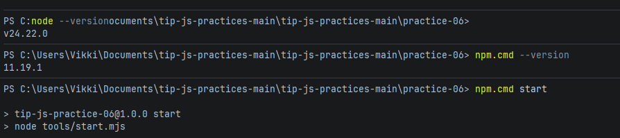

### 2.2. Команды и адреса

Открыть терминал в каталоге `practice-06` и выполнить:

```bash
npm start
```

Если в Windows PowerShell блокируется запуск `npm.ps1`, использовать:

```powershell
npm.cmd start
```

Одна команда запускает API и сервер браузерного приложения. Закрывать терминал во время проверки не нужно; остановка — `Ctrl+C`.

| Назначение | Адрес |
|---|---|
| Основное приложение | `http://127.0.0.1:5506/` |
| Индивидуальный вариант № 3 | `http://127.0.0.1:5506/?dataset=variant` |
| Браузерные проверки | `http://127.0.0.1:5506/checks.html` |
| API | `http://127.0.0.1:5505/api` |
| Проверка API | `http://127.0.0.1:5505/api/health` |

Приложение открывается по HTTP, а не через `file://`. Для запуска не требуется устанавливать дополнительные зависимости через `npm install`.

## 3. Структура и реализация

### 3.1. Основные файлы

| Файл | Назначение |
|---|---|
| `api/data.js`, `api/server.mjs` | Исходные данные и учебный HTTP API |
| `src/api-client.js` | Общий HTTP-клиент, запросы, заголовки, ошибки, тайм-аут и отмена |
| `src/task-api.js` | Операции над задачами и категориями, фильтры и проверка ответов |
| `src/form-validation.js` | Проверка и нормализация полей формы |
| `src/task-view.js` | Безопасное формирование карточек задач |
| `src/app-controller.js` | Состояния интерфейса, загрузка и изменяющие операции |
| `src/dom-app.js` | Обработчики DOM, сообщения и отображение времени загрузки |
| `src/main.js` | Инициализация приложения |
| `src/variant.js` | Настройки индивидуального варианта № 3 |
| `index.html`, `styles.css` | Разметка и оформление интерфейса |
| `checks/`, `checks.html` | Автоматизированные проверки |
| `qa/`, `reports/` | Дополнительные сценарии и протоколы проверок |
| `tools/` | Совместный запуск API и статического сервера |

### 3.2. HTTP-клиент и предметный API

В `src/api-client.js` реализован общий клиент на основе `fetch`. Он поддерживает методы `GET`, `POST`, `PATCH` и `DELETE`, параметры URL через `URLSearchParams`, заголовок `Accept: application/json` и передачу JSON-тела с `Content-Type: application/json`. Успешный ответ `204 No Content` преобразуется в `null` без попытки прочитать JSON.

Ошибки различаются по типам: `http`, `network`, `invalid-response`, `timeout` и `aborted`. Запросы поддерживают `AbortSignal`, тайм-аут и внешнюю отмену. HTTP-клиент отделён от DOM.

В `src/task-api.js` реализованы следующие операции:

| Метод | HTTP-запрос | Назначение |
|---|---|---|
| `getTasks` | `GET /tasks` | Список задач с фильтрами |
| `getTaskById` | `GET /tasks/:id` | Получение задачи |
| `getCategories` | `GET /categories` | Категории |
| `loadInitialData` | Параллельные `GET` | Начальная загрузка задач и категорий |
| `createTask` | `POST /tasks` | Создание задачи |
| `updateTask` | `PATCH /tasks/:id` | Редактирование |
| `setTaskCompleted` | `PATCH /tasks/:id` | Изменение статуса |
| `deleteTask` | `DELETE /tasks/:id` | Удаление |
| `resetDemoData` | `POST /debug/reset` | Восстановление учебных данных |

Для первоначальной загрузки задач и категорий используется `Promise.all`. Проверяются идентификаторы, допустимые фильтры и структура ответа сервера.

### 3.3. Форма и состояния интерфейса

Форма принимает название задачи длиной от 1 до 100 символов после удаления пробелов по краям, приоритет `low`, `medium` или `high` и существующую категорию. При ошибке отображается сообщение у соответствующего поля; некорректные данные не отправляются.

Контроллер различает четыре состояния:

- `loading` — запрос выполняется;
- `ready` — данные получены и отображены;
- `empty` — запрос успешен, но задач по фильтрам нет;
- `error` — данные не удалось загрузить, доступна повторная попытка.

После создания, изменения статуса, редактирования или удаления выполняется повторный `GET` с текущими фильтрами. Во время мутации блокируются повторные действия. Для защиты от устаревших результатов используются `AbortController` и номер актуальной загрузки. Названия задач выводятся через `textContent`, а не через небезопасную HTML-вставку.

## 4. Индивидуальный вариант № 3

**Начальный фильтр:** `priority=high`.

При открытии адреса `http://127.0.0.1:5506/?dataset=variant` отправляется запрос:

```http
GET /api/tasks?priority=high
```

Первоначально отображается **5 задач** высокого приоритета (ID `4`, `13`, `16`, `25`, `34`).

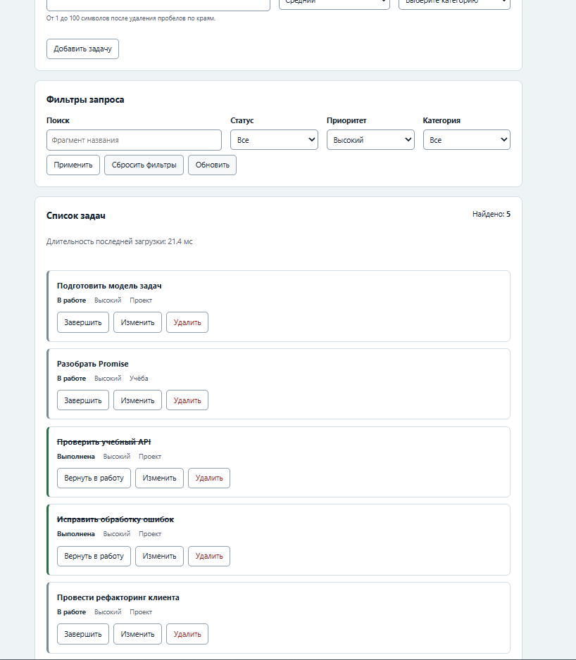

**Индивидуальный сценарий:** изменить приоритет задачи с ID `4` с `high` на `medium` и сохранить изменение. Приложение отправляет `PATCH`, затем повторяет запрос списка с прежним фильтром `priority=high`.

После сохранения изменённая задача больше не подходит под фильтр и исчезает из списка. В интерфейсе остаётся **4 задачи**, отображается сообщение «Изменения сохранены».

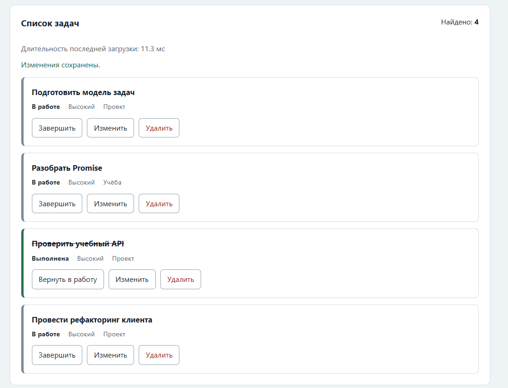

Это подтверждает, что фильтрация выполняется на сервере, а список обновляется после изменения данных.

## 5. Результаты автоматизированных проверок

### 5.1. Проверки Node.js — 70/70

Во втором терминале из папки `practice-06` выполнена команда:

```powershell
npm.cmd test
```

Она запускает проверки API, модулей и интеграции.

**Проверки API — 23/23.** Проверены маршруты, фильтры, HTTP-статусы, создание и изменение задач, удаление, CORS и восстановление данных.

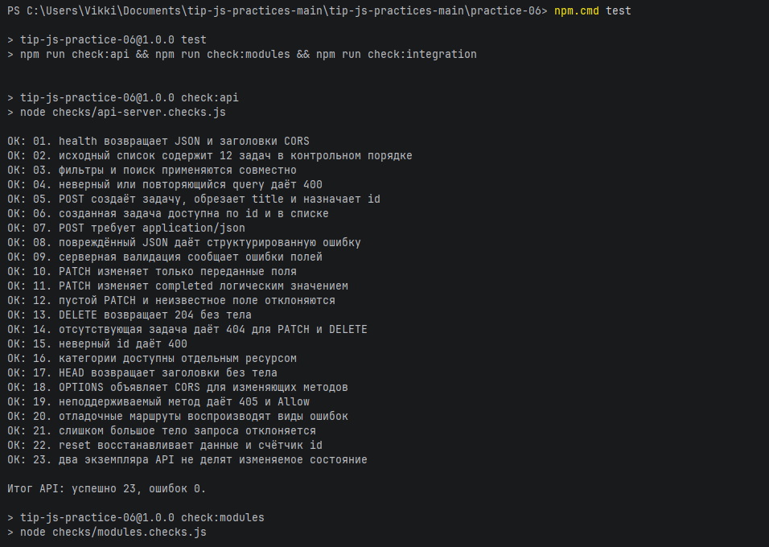

**Проверки модулей — 33/33.** Проверены HTTP-клиент, обработка ошибок, предметный API, валидация, контроллер и защита от устаревшего ответа.

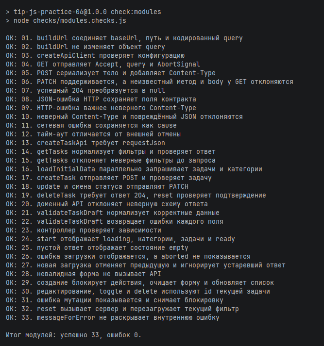

**Интеграционные проверки — 14/14.** Проверено взаимодействие клиента с реальным API, полный набор операций, тайм-аут, отмена и восстановление данных.

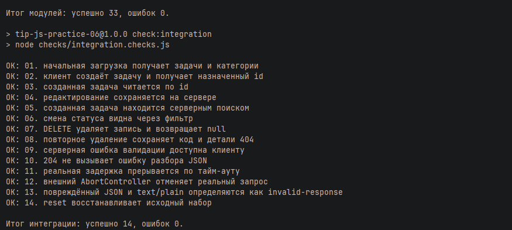

### 5.2. Собственные проверки — 14/14

Выполнена команда:

```powershell
npm.cmd run check:own
```

Пройдены дополнительные проверки сигналов отмены, неверных ответов, валидации, двойной отправки формы, гонки запросов, обработки ошибок и уничтожения контроллера.

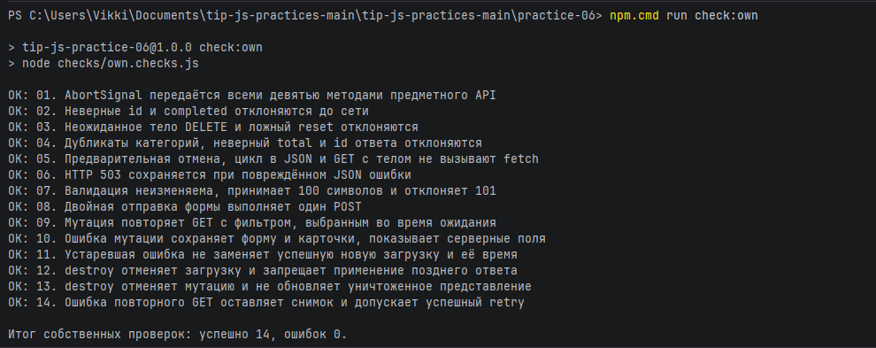

### 5.3. Браузерные проверки — 14/14

При работающем приложении открыта страница `http://127.0.0.1:5506/checks.html`.

Результат: **«Всего: 14. Пройдено: 14. Ошибок: 0».** Проверены отрисовка карточек, загрузка, фильтры, пустой список, создание, валидация, редактирование, статус, удаление, сброс и обработка недоступности API.

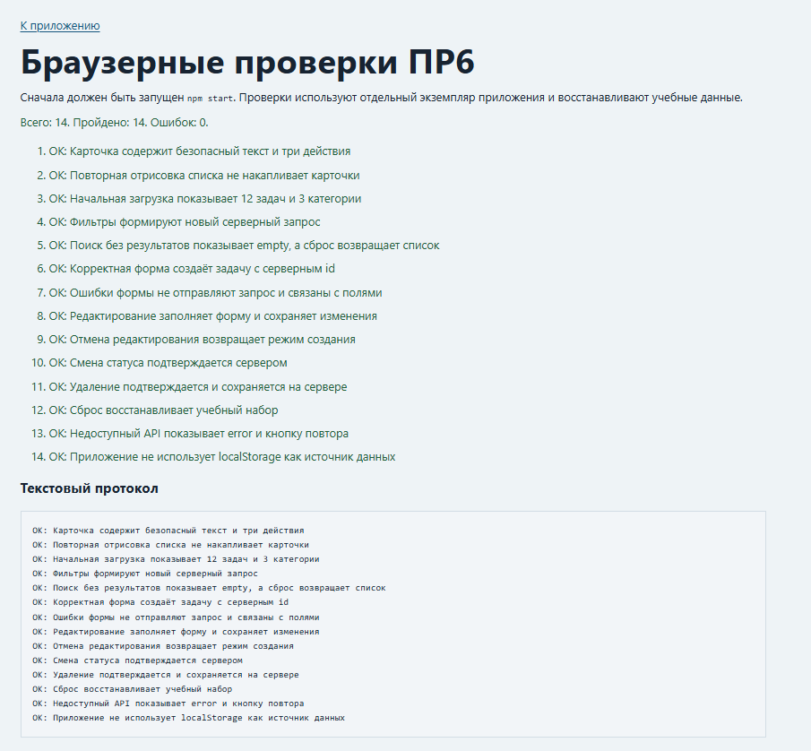

### 5.4. Общий результат

| Группа проверок | Успешно | Ошибок |
|---|---:|---:|
| API | 23 | 0 |
| Модули | 33 | 0 |
| Интеграция | 14 | 0 |
| Собственные | 14 | 0 |
| Браузерные | 14 | 0 |
| **Итого** | **98** | **0** |

## 6. Проверки интерфейса в браузере

### 6.1. Пустая выборка

В строку поиска введено `несуществующая_задача_12345`, затем применён фильтр. Сервер вернул пустую выборку: счётчик показывает **«Найдено: 0»**, в интерфейсе выводится сообщение **«По выбранным условиям задач нет»**.

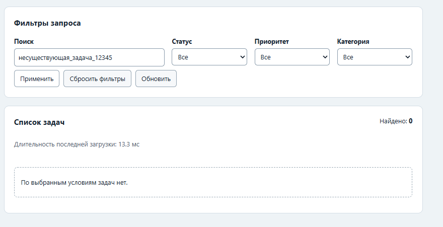

### 6.2. Ошибка валидации

При попытке создать задачу с названием из пробелов поле выделяется красным и появляется сообщение: **«Название должно содержать от 1 до 100 символов после удаления пробелов»**. Отправка невалидной формы без запроса к API дополнительно подтверждена автоматическими проверками.

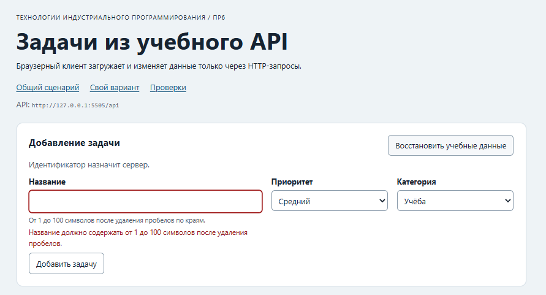

### 6.3. Создание задачи

Через форму создана задача **«Тестовая задача ПР6»** с высоким приоритетом в категории «Проект». Она появилась в общем списке со статусом **«В работе»**.

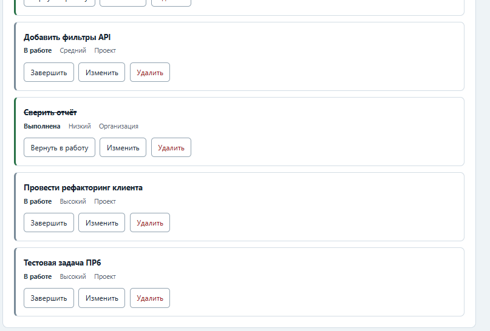

Время существования данных ограничено работой учебного API: при перезапуске сервера исходный набор восстанавливается. Сохранение после обновления страницы и другие дополнительные сценарии были покрыты автоматическим воспроизведением через DOM; отдельного ручного скриншота обновления страницы здесь нет. Подробности автоматических сценариев сохранены в `reports/scenarios.txt` и `reports/scenarios.json`.

## 7. Дополнительное задание № 5

Реализовано измерение **длительности последней загрузки** через `performance.now()`. Значение отображается в миллисекундах рядом со списком задач. При начальном открытии измеряется параллельная загрузка задач и категорий, далее — загрузка актуального списка. Устаревшие и отменённые запросы не перезаписывают измерение.

Показатель можно увидеть на скриншотах индивидуального варианта и пустой выборки. Например, при пустой выборке отображалось **13,3 мс**. Конкретное время зависит от условий запуска.

## 8. Ответы на контрольные вопросы

1. **Почему `fetch` не отклоняет Promise при 404 или 500?** HTTP-ответ получен; его статус необходимо проверить через `response.ok`. Отклонение обычно связано с сетевой ошибкой или отменой.
2. **Каков правильный порядок обработки ответа?** Сначала HTTP-статус, затем успешный `204`, потом `Content-Type` и разбор JSON.
3. **Чем `POST` отличается от `PATCH`?** `POST` создаёт новую задачу, `PATCH` изменяет переданные поля уже существующей.
4. **Для чего нужны `201` и `Location`?** `201 Created` подтверждает создание ресурса, `Location` может указывать адрес созданного ресурса.
5. **Почему для `204` не вызывается `json()`?** У ответа нет тела, и попытка разобрать пустое содержимое вызовет ошибку.
6. **Когда нужен CORS preflight?** Например, для междоменных `PATCH`, `DELETE` и отправки JSON с `Content-Type: application/json`. Режим `no-cors` не позволяет прочитать нужный JSON-ответ.
7. **Чем `empty` отличается от `error`?** `empty` — успешный запрос без найденных задач; `error` — загрузка или обработка завершилась ошибкой.
8. **Почему `localStorage` не используется для задач?** Источником истины является сервер, а отдельная локальная копия могла бы расходиться с его состоянием.
9. **Зачем повторный `GET` после изменения?** Чтобы получить подтверждённое состояние сервера и актуальную выборку с текущими фильтрами.
10. **Как возникает гонка запросов?** Медленный старый запрос может завершиться после нового и без защиты заменить актуальные данные.
11. **Почему одного `AbortController` недостаточно?** Отмена не всегда гарантирует, что поздний результат не поступит; номер последовательности позволяет его проигнорировать.
12. **Почему отмена не показывается как ошибка?** При смене фильтра это штатное завершение уже неактуального запроса.
13. **Что проверяют клиент и сервер?** Клиент — корректность формы и ответов для интерфейса, сервер — допустимость запросов и сохраняемых данных.
14. **Зачем передавать `view` в контроллер параметром?** Для отделения бизнес-логики от DOM и удобства модульного тестирования.
15. **Почему используется `textContent`?** Он выводит пользовательский текст буквально, не выполняя HTML или встроенные обработчики событий.

## 9. Вывод

В практической работе № 6 реализовано браузерное приложение, взаимодействующее с HTTP API. Выполнены операции чтения, создания, редактирования, завершения и удаления задач, фильтрация, клиентская валидация, обработка ошибок, состояния загрузки и защита от гонки запросов. **Индивидуальный вариант № 3** и **дополнительное задание № 5** выполнены.

Локальными скриншотами подтверждены **98 успешных автоматических проверок без ошибок**, индивидуальный сценарий и несколько проверок интерфейса. Дополнительные результаты автоматического воспроизведения сценариев приведены в папке `reports`.
