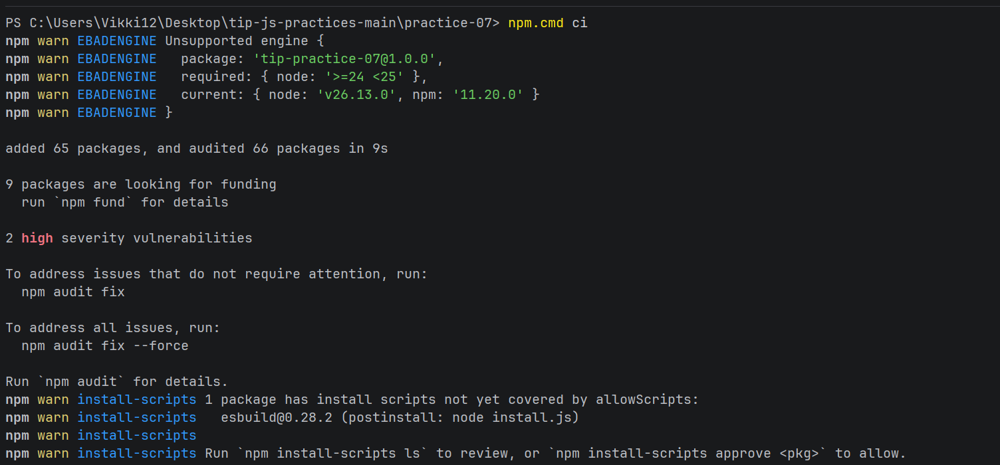
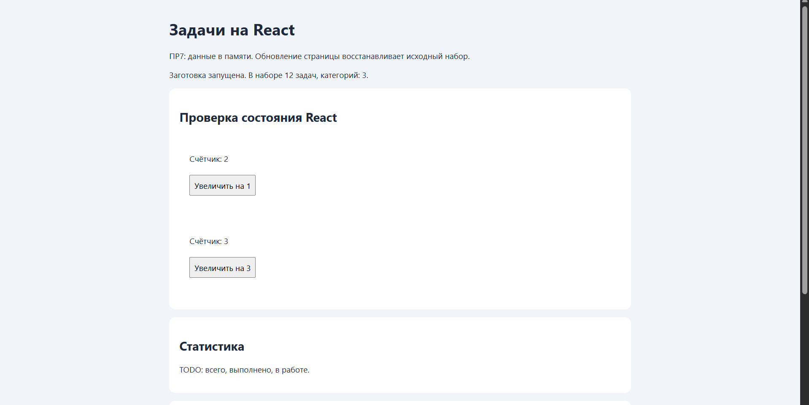
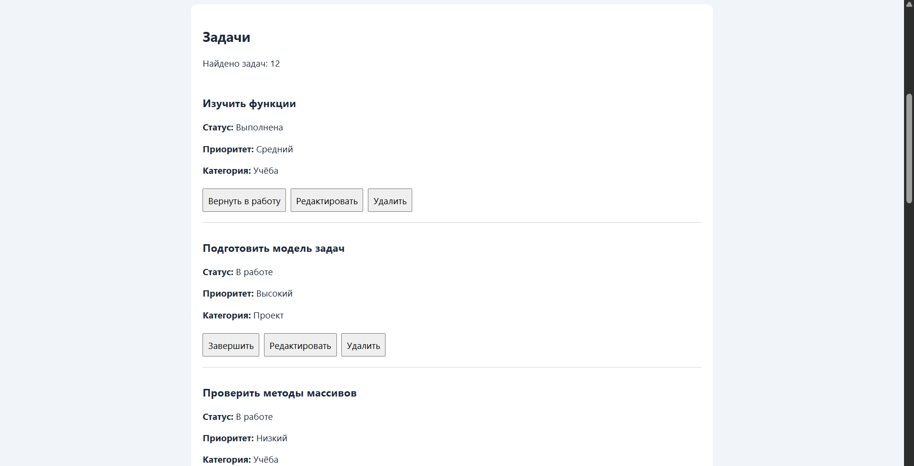
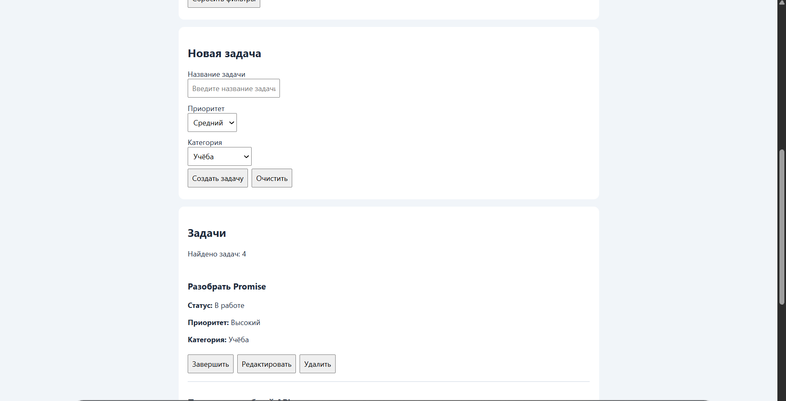
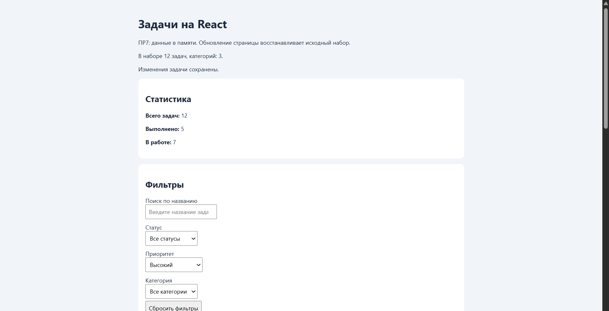
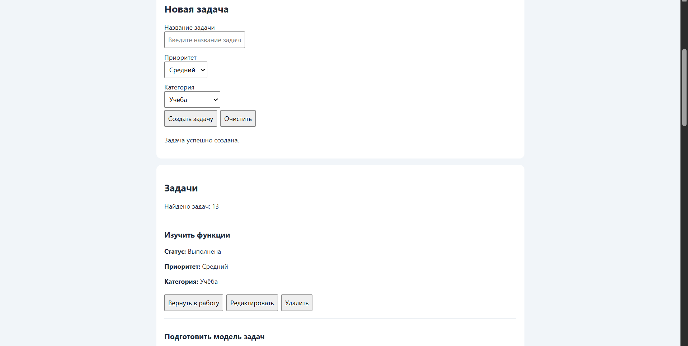
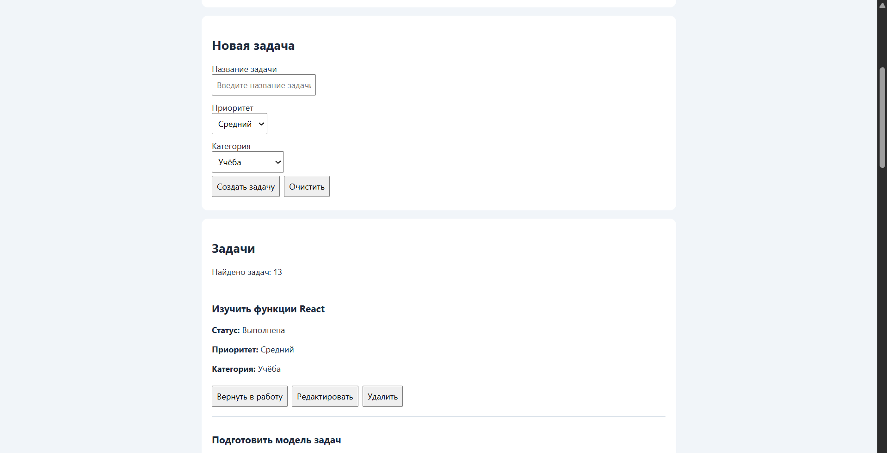
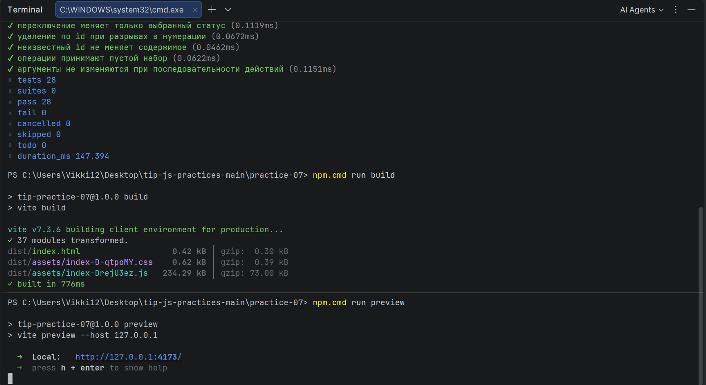

# Практическая работа № 7

**Тема:** Создание компонентного интерфейса на React

**Дисциплина:** Технологии индустриального программирования  

**Автор:** Виктория Сутормина 

**Группа:** ЭФБО-06-25 

**Вариант:** № 3

## 1. Цель работы

Освоить JSX, функциональные компоненты React, передачу данных через `props` и управление состоянием через `useState`. Реализовать интерфейс для создания, редактирования, фильтрации и удаления задач со статистикой и проверкой данных.

В ПР7 задачи хранятся **в памяти страницы**: после перезагрузки восстанавливается исходный набор. HTTP API и `localStorage` не используются.

## 2. Окружение и запуск

**Рабочий каталог:** `tip-js-practices-main/practice-07`.  
**Фактические версии:** Node.js `26.13.0`, npm `11.20.0`, Git `2.56.0.windows.4`, Vite `7.3.6`.

```powershell
cd practice-07
npm.cmd ci
npm.cmd run dev
# В отдельном терминале:
npm.cmd test
npm.cmd run build
npm.cmd run preview
```

Dev: `http://127.0.0.1:5173/`; preview: `http://127.0.0.1:4173/`.

**Примечание:** методичка требует Node.js **24.x**, а установлен Node.js 26; поэтому `npm ci` выдал `EBADENGINE`, хотя установка и сборка прошли. Для точного соответствия среду следует проверить на Node.js 24.x.



## 3. Реализация

| Компонент / файл | Назначение |
|---|---|
| `App.jsx` | Хранит `tasks`, `filters`, `editingId`; передаёт дочерним компонентам `props` и обработчики действий |
| `TaskItem.jsx`, `TaskList.jsx` | Карточки, статусы, приоритеты, категории, кнопки и пустое состояние |
| `TaskForm.jsx` | Управляемая форма; проверка полей, создание, редактирование и отмена |
| `TaskFilters.jsx`, `TaskStats.jsx` | Четыре совместных фильтра; статистика всего массива |
| `domain/task-service.js` | Семь чистых функций валидации, поиска, статистики и изменения задач |

`App` вычисляет видимые записи через `selectTasks(tasks, filters)`, а статистику через `getTaskStats(tasks)` **без дополнительного состояния**. Изменения массива выполняются неизменяемо (`map`, `filter`, `[...tasks, item]`), чтобы React корректно обновлял экран. Карточки имеют стабильный `key={task.id}`, а `key={editingId ?? 'new'}` пересоздаёт форму при смене редактируемой задачи. Действия идут из дочерних компонентов в `App` через функции обратного вызова. Подтверждение удаления вызывается до изменения состояния.

Отдельно проверены два экземпляра `Counter` с шагами 1 и 3: после нажатий получены **2** и **3**, что подтверждает независимость `useState`.





## 4. Индивидуальный вариант № 3

В `src/variant.js` задано `export const variant = 3`. Начальный фильтр — **высокий приоритет**: при 12 задачах найдено **4**. Сценарий — изменить приоритет одной видимой задачи на средний. После сохранения задача должна исчезнуть из выборки, но остаться в общем списке; ожидается **3** найденные задачи, статистика — **12 / 5 / 7**.

В браузере получено сообщение **«Изменения задачи сохранены»**; общая статистика осталась **12 / 5 / 7**. Согласно условию фильтра, после смены приоритета с высокого на средний количество видимых записей должно измениться с 4 до 3. Скриншоты показывают состояние до изменения и подтверждение сохранения.





## 5. Фактические проверки

| Проверка | Результат |
|---|---|
| Исходный набор / статистика | 12 задач, 3 категории; выполнено 5, в работе 7 |
| Пустое название | Ошибка валидации отображена у поля |
| Создание задачи | Сообщение об успехе, количество 12 → 13, форма очищена |
| Редактирование выполненной задачи | Название изменено на «Изучить функции React», статус сохранён, количество осталось 13 |
| `npm.cmd test` | **28 тестов пройдено, 0 ошибок** |
| `npm.cmd run build` | Успешно: 37 модулей; `built in 776ms` |
| `npm.cmd run preview` | Сервер запущен на порту 4173 |








**Проверка интерфейса:** в браузере подтверждены отображение исходного набора, работа управляемой формы, сообщение об ошибке при пустом названии, создание и редактирование задачи, а также начальная фильтрация варианта № 3. В приложении предусмотрены переключение статуса, подтверждение удаления, совместная работа фильтров, сообщение о пустой выборке и восстановление исходных данных после перезагрузки. Автоматические тесты проверяют предметную логику; отдельные сценарии интерфейса проверяются вручную.

## 6. Ответы на контрольные вопросы

1. **JSX и HTML:** JSX — синтаксис JavaScript для описания элементов React, а не HTML-строка.
2. **Props и состояние:** `props` передаются родителем; состояние хранится и обновляется самим компонентом.
3. **Почему `useState`:** изменение обычной переменной не сохраняет её между рендерами и не обновляет интерфейс.
4. **Функциональное обновление:** требуется, когда новое значение зависит от предыдущего (`setTasks(prev => ...)`).
5. **Почему без мутаций:** копирование массива не копирует объекты внутри; их нужно заменять новыми.
6. **Зачем `key`:** помогает React узнавать записи; индекс ненадёжен при удалении и изменении списка.
7. **Почему статистика не в состоянии:** она вычисляется из `tasks`, иначе возможна рассинхронизация.
8. **Как действие идёт наверх:** дочерний компонент вызывает callback из `props`.
9. **Управляемое поле:** его `value` хранится в состоянии и меняется через `onChange`.
10. **Почему преобразуем `categoryId`:** HTML `select` отдаёт строку, а модель хранит число.
11. **Смена `key` формы:** React создаёт новую форму и сбрасывает локальный черновик.
12. **Почему `confirm` снаружи:** updater состояния должен оставаться чистой функцией.
13. **Пустая выборка и пустой набор:** сравниваются длины `tasks` и `visibleTasks`.
14. **Что делает `npm test`:** проверяет чистые функции, но не работу React-интерфейса.
15. **Что изменится в ПР8:** локальные операции заменятся асинхронными API-запросами с загрузкой и обработкой ошибок.

## 7. Вывод

Реализовано React-приложение для управления задачами с компонентами, состоянием `useState`, формой с проверкой ввода, четырьмя фильтрами и статистикой. **Все 28 предметных тестов пройдены**, сборка Vite выполнена успешно; приложение запущено в режимах разработки и preview. Для полного соответствия заданному окружению рекомендуется Node.js 24.x.
