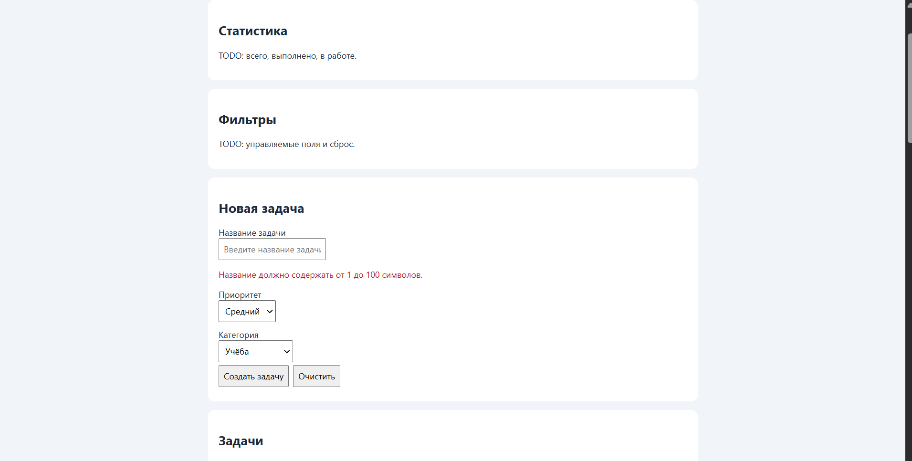

# Практическая работа № 7

**Тема:** Создание компонентного интерфейса на React

**Дисциплина:** Технологии индустриального программирования  

**Автор:** Виктория Сутормина 

**Группа:** ЭФБО-06-25 

**Вариант:** № 3

## 1. Цель работы

Освоить JSX, функциональные компоненты React, передачу данных через `props` и управление состоянием через `useState`. Реализовать интерфейс для создания, редактирования, фильтрации и удаления задач со статистикой и проверкой данных.

В ПР7 задачи хранятся **в памяти страницы**: после перезагрузки восстанавливается исходный набор. HTTP API и `localStorage` не используются.

## 2. Окружение и запуск

**Рабочий каталог:** `tip-js-practices-main/practice-07`.  
**Фактические версии:** Node.js `26.13.0`, npm `11.20.0`, Git `2.56.0.windows.4`, Vite `7.3.6`.

```powershell
cd practice-07
npm.cmd ci
npm.cmd run dev
# В отдельном терминале:
npm.cmd test
npm.cmd run build
npm.cmd run preview
```

Dev: `http://127.0.0.1:5173/`; preview: `http://127.0.0.1:4173/`.

**Примечание:** методичка требует Node.js **24.x**, а установлен Node.js 26; поэтому `npm ci` выдал `EBADENGINE`, хотя установка и сборка прошли. Для точного соответствия среду следует проверить на Node.js 24.x.


## 3. Реализация

| Компонент / файл | Назначение |
|---|---|
| `App.jsx` | Хранит `tasks`, `filters`, `editingId`; передаёт дочерним компонентам `props` и обработчики действий |
| `TaskItem.jsx`, `TaskList.jsx` | Карточки, статусы, приоритеты, категории, кнопки и пустое состояние |
| `TaskForm.jsx` | Управляемая форма; проверка полей, создание, редактирование и отмена |
| `TaskFilters.jsx`, `TaskStats.jsx` | Четыре совместных фильтра; статистика всего массива |
| `domain/task-service.js` | Семь чистых функций валидации, поиска, статистики и изменения задач |

`App` вычисляет видимые записи через `selectTasks(tasks, filters)`, а статистику через `getTaskStats(tasks)` **без дополнительного состояния**. Изменения массива выполняются неизменяемо (`map`, `filter`, `[...tasks, item]`), чтобы React корректно обновлял экран. Карточки имеют стабильный `key={task.id}`, а `key={editingId ?? 'new'}` пересоздаёт форму при смене редактируемой задачи. Действия идут из дочерних компонентов в `App` через функции обратного вызова. Подтверждение удаления вызывается до изменения состояния.

Отдельно проверены два экземпляра `Counter` с шагами 1 и 3: после нажатий получены **2** и **3**, что подтверждает независимость `useState`.


## 4. Индивидуальный вариант № 3

В `src/variant.js` задано `export const variant = 3`. Начальный фильтр — **высокий приоритет**: при 12 задачах найдено **4**. Сценарий — изменить приоритет одной видимой задачи на средний. После сохранения задача должна исчезнуть из выборки, но остаться в общем списке; ожидается **3** найденные задачи, статистика — **12 / 5 / 7**.

Для варианта №3 реализовано изменение приоритета задачи с высокого на средний. При действующем фильтре «Высокий» обновлённая запись исключается из выборки, при этом остаётся в полном массиве задач. В браузере получено сообщение **«Изменения задачи сохранены»**, общая статистика остаётся **12 / 5 / 7**. Скриншоты показывают исходную фильтрацию и подтверждение сохранения.


## 5. Фактические проверки

| Проверка | Результат |
|---|---|
| Исходный набор / статистика | 12 задач, 3 категории; выполнено 5, в работе 7 |
| Пустое название | Ошибка валидации отображена у поля |
| Создание задачи | Сообщение об успехе, количество 12 → 13, форма очищена |
| Редактирование выполненной задачи | Название изменено на «Изучить функции React», статус сохранён, количество осталось 13 |
| `npm.cmd test` | **28 тестов пройдено, 0 ошибок** |
| `npm.cmd run build` | Успешно: 37 модулей; `built in 776ms` |
| `npm.cmd run preview` | Сервер запущен на порту 4173 |




**Ручное тестирование интерфейса:** приложение запускалось в браузере; проверены отображение исходных задач и статистики, независимые счётчики React, обработка пустого названия, создание новой задачи (12 → 13), редактирование с сохранением статуса и работа начального фильтра варианта №3. Для варианта №3 проверено сообщение об успешном сохранении после изменения приоритета. Предусмотренные заданием переключение статуса, подтверждение удаления, совместные фильтры, пустое состояние и сброс при перезагрузке реализованы в коде. **Автоматические тесты: 28 успешно, 0 ошибок. Сборка Vite выполнена успешно.**

### Ручные сценарии по методичке: ожидаемые результаты

Перед каждым независимым сценарием при необходимости сбрасываются фильтры. Таблица ниже описывает **ожидаемое поведение** приложения; фактически подтверждённые результаты приведены выше.

| № | Сценарий | Ожидаемый результат |
|---:|---|---|
| 1 | Сброс фильтров | 12 карточек; статистика: всего 12, выполнено 5, в работе 7. |
| 2 | Название из пробелов | Сообщение об ошибке у названия; задача не добавлена, ввод сохранён. |
| 3 | Название из 100 и 101 символа | 100 символов принимаются; 101 символ отклоняется. |
| 4 | Создание «  Новая задача  » | Название сохраняется без крайних пробелов, статус «В работе», форма очищена. |
| 5 | Редактирование выполненной задачи | Новые данные сохранены, статус «Выполнена» не изменился. |
| 6 | Переход от редактирования A к B | Поля заполняются данными B, черновик A не переносится. |
| 7 | Отмена редактирования | Задача не изменяется, открывается форма создания. |
| 8 | Два переключения статуса | Исходный статус и значения статистики восстановлены. |
| 9 | Отмена и подтверждение удаления | При отказе задача остаётся, при подтверждении удаляется. |
| 10 | Удаление редактируемой задачи | Удалённая запись исчезает, форма переходит в режим создания. |
| 11 | Одновременное применение четырёх фильтров | Показаны только задачи, соответствующие всем заданным условиям. |
| 12 | Поиск без совпадений и сброс | Сначала отображается пустое состояние, после сброса — текущий полный список. |
| 13 | Создание задачи вне текущего фильтра | Общая статистика увеличивается, новая карточка скрыта до смены фильтра. |
| 14 | Название с HTML-подобным текстом | Название отображается как обычный текст, код не выполняется. |
| 15 | Удаление всех задач и создание новой | Список пуст и счётчики равны нулю; новая задача успешно создаётся. |
| 16 | Перезагрузка страницы | Восстанавливаются исходные 12 задач и фильтр варианта №3. |
| 17 | Работа с клавиатурой | Фокус виден, поля подписаны, действия доступны без мыши. |
| 18 | Сценарий варианта №3 в preview | Результат соответствует dev-режиму: после смены приоритета видимых задач 4 → 3, всего задач 12. |

## 6. Ответы на контрольные вопросы

1. **JSX и HTML:** JSX — синтаксис JavaScript для описания элементов React, а не HTML-строка.
2. **Props и состояние:** `props` передаются родителем; состояние хранится и обновляется самим компонентом.
3. **Почему `useState`:** изменение обычной переменной не сохраняет её между рендерами и не обновляет интерфейс.
4. **Функциональное обновление:** требуется, когда новое значение зависит от предыдущего (`setTasks(prev => ...)`).
5. **Почему без мутаций:** копирование массива не копирует объекты внутри; их нужно заменять новыми.
6. **Зачем `key`:** помогает React узнавать записи; индекс ненадёжен при удалении и изменении списка.
7. **Почему статистика не в состоянии:** она вычисляется из `tasks`, иначе возможна рассинхронизация.
8. **Как действие идёт наверх:** дочерний компонент вызывает callback из `props`.
9. **Управляемое поле:** его `value` хранится в состоянии и меняется через `onChange`.
10. **Почему преобразуем `categoryId`:** HTML `select` отдаёт строку, а модель хранит число.
11. **Смена `key` формы:** React создаёт новую форму и сбрасывает локальный черновик.
12. **Почему `confirm` снаружи:** updater состояния должен оставаться чистой функцией.
13. **Пустая выборка и пустой набор:** сравниваются длины `tasks` и `visibleTasks`.
14. **Что делает `npm test`:** проверяет чистые функции, но не работу React-интерфейса.
15. **Что изменится в ПР8:** локальные операции заменятся асинхронными API-запросами с загрузкой и обработкой ошибок.

## 7. Вывод

В ходе практической работы реализовано React-приложение для управления задачами с компонентами, состоянием `useState`, управляемой формой, проверкой ввода, четырьмя фильтрами, статистикой и операциями над задачами. Реализован индивидуальный вариант №3. **Все 28 предметных тестов пройдены (ошибок 0), сборка Vite успешна**. Приложение запускается в режимах разработки и preview.
