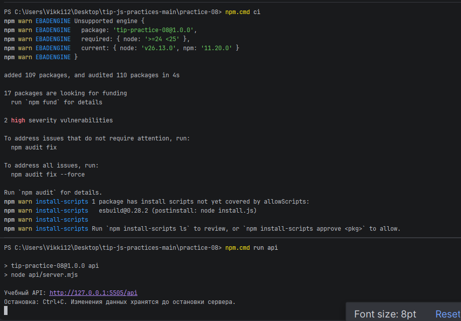
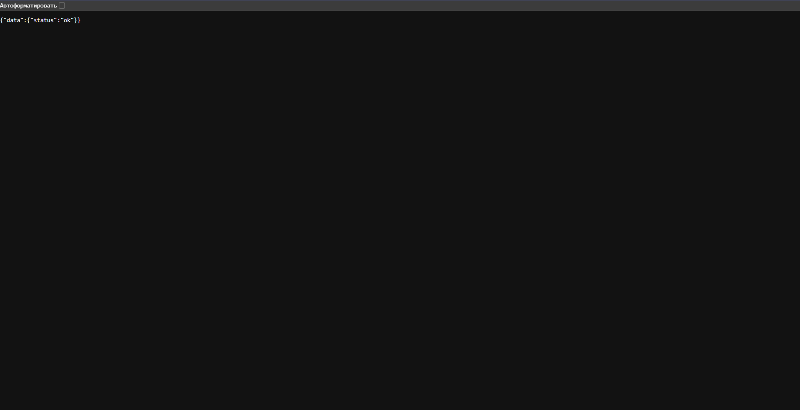
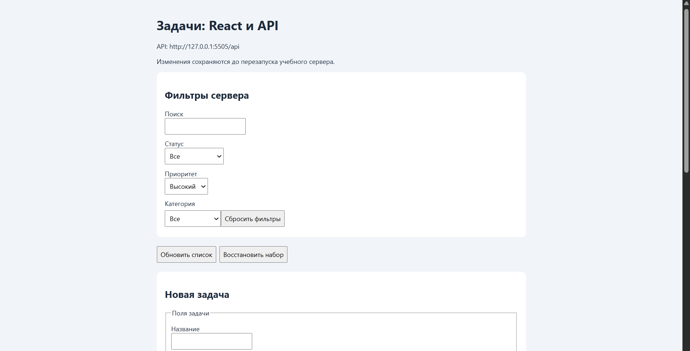
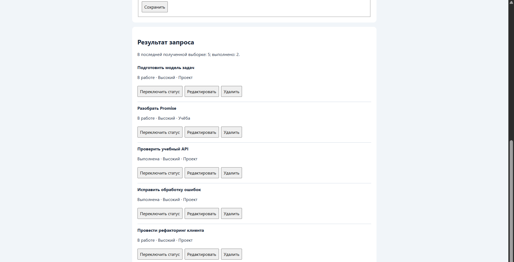
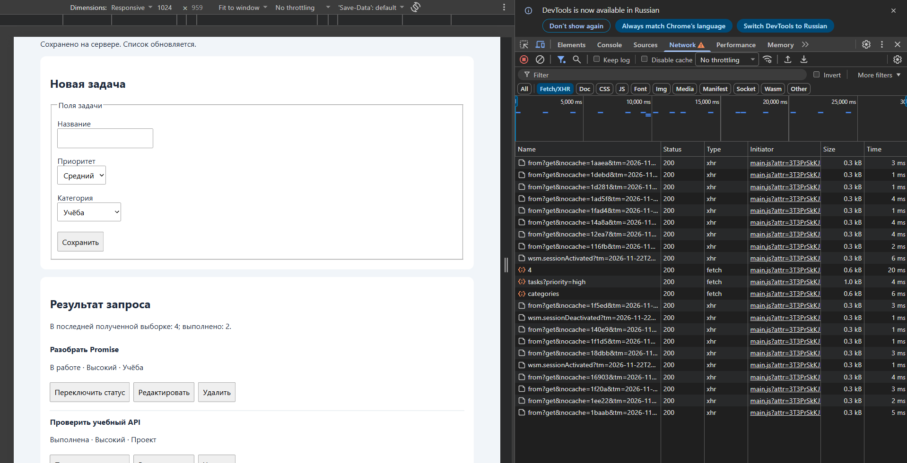
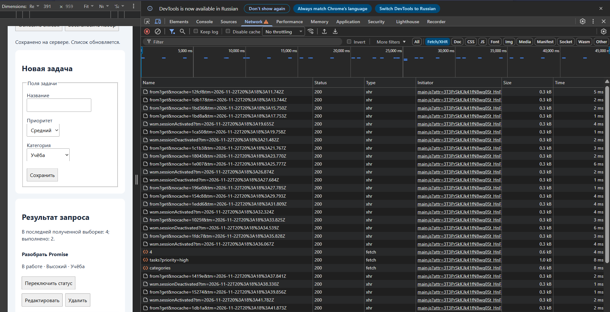
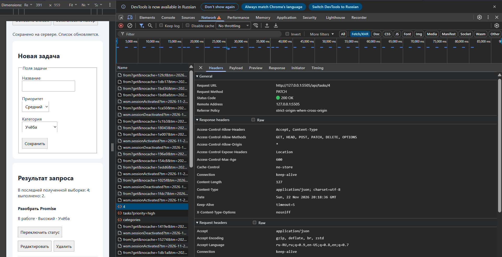
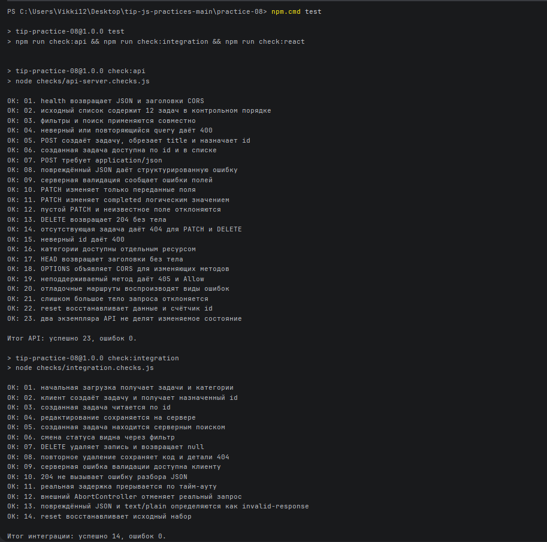
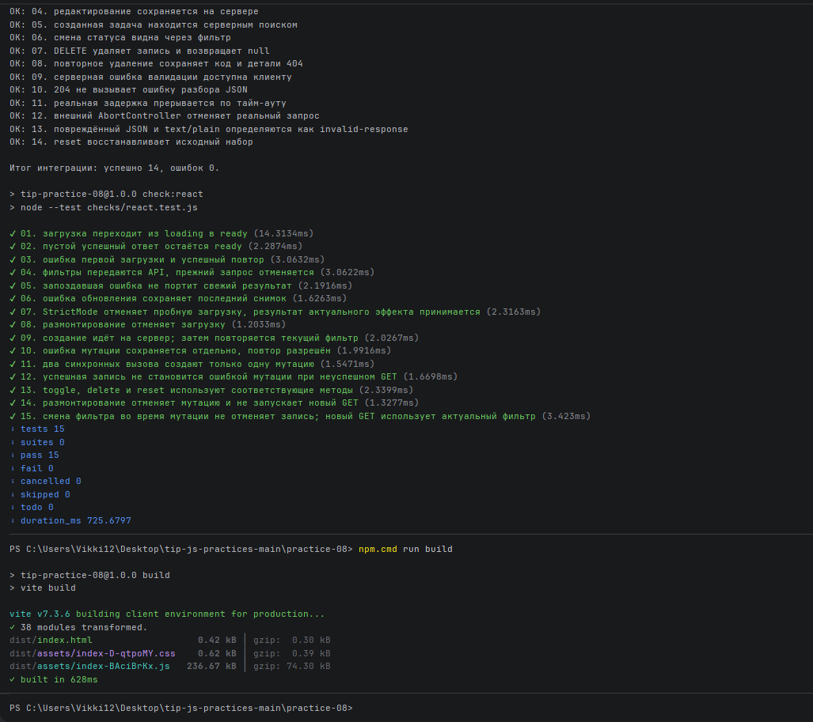
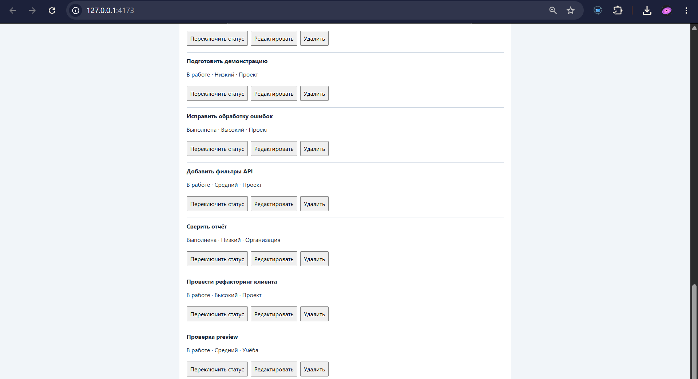

# Практическая работа № 8

**Тема:** Работа React-приложения с API  

**Дисциплина:** Технологии индустриального программирования  

**Автор:** Виктория Сутормина 

**Группа:** ЭФБО-06-25 

**Вариант:** № 3


## 1. Цель работы

Организовать взаимодействие React-приложения с учебным HTTP API: загрузку данных, серверную фильтрацию, создание, редактирование и удаление задач. Освоить `useEffect`, `useRef`, `AbortController`, обработку ошибок, отмену устаревших запросов и повторный GET после записи.

В отличие от ПР7, задачи хранятся в памяти процесса API: обновление страницы не сбрасывает изменения, а перезапуск сервера восстанавливает исходные данные.

## 2. Окружение и запуск

**Рабочая папка:** `practice-08`. **Фактическое окружение:** Node.js `26.13.0`, npm `11.20.0`, Vite `7.3.6`, Windows, WebStorm, Chrome. В методичке предусмотрен Node.js **24.x**; при установке на Node.js 26 появлялось предупреждение `EBADENGINE`, однако установка, тесты и сборка завершились успешно.

```powershell
cd practice-08
npm.cmd ci
```

Первый терминал — учебный сервер:

```powershell
npm.cmd run api
```

API: `http://127.0.0.1:5505/api`; проверка `/api/health` вернула `{"data":{"status":"ok"}}`.

Второй терминал — клиент:

```powershell
npm.cmd run dev
```

React: `http://127.0.0.1:5173/`. Для проверки готовой сборки: `npm.cmd run build`, затем `npm.cmd run preview` (`http://127.0.0.1:4173/`), при работающем API.





## 3. Реализация

| Файл / компонент | Назначение |
|---|---|
| `App.jsx` | Фильтры, выбранная задача, отображение состояний и обработчики действий |
| `TaskForm.jsx`, `TaskFilters.jsx`, `TaskList.jsx` | Асинхронная форма, серверные фильтры, список и кнопки управления |
| `hooks/useTaskData.js` | Загрузка данных, обновление, отмена запросов и операции изменения |
| `task-api.js`, `api-client.js` | Предметные методы API, `fetch`, обработка HTTP-ответов и ошибок |
| `api/server.mjs` | Учебный сервер с данными в памяти процесса |

Хук `useTaskData({ api, filters })` хранит последний успешный `snapshot`, состояния `loading / ready / error`, ошибки чтения и изменения, а также `pending`. Эффект загрузки зависит от стабильного `api`, четырёх значений фильтров (`q`, `completed`, `priority`, `categoryId`) и счётчика `revision`.

Для каждого GET создаётся `AbortController`; cleanup помечает запрос неактуальным и вызывает `abort()`. Устаревшие ответы **и ошибки** не изменяют интерфейс. При сбое нового GET последний успешный снимок сохраняется.

POST, PATCH, DELETE и сброс выполняются отдельно от эффекта. `useRef` немедленно блокирует повторную мутацию; отдельный контроллер не позволяет смене фильтра отменить запись. Успешная операция запускает новый GET, ошибка изменения показывается отдельно от ошибки обновления. Форма сохраняет черновик при неуспешной записи.



## 4. Индивидуальный вариант № 3

В `src/variant.js` установлено `export const variant = 3`. Начальное условие — **`priority=high`**. Из 12 исходных задач сервер возвращает **5** записей высокого приоритета.

Выполнено редактирование задачи **«Подготовить модель задач»** (`id = 4`): приоритет изменён с `high` на `medium`.

| Этап | HTTP-запрос | Статус / результат |
|---|---|---|
| Начальная выборка | `GET /api/tasks?priority=high` | `200`, 5 задач |
| Сохранение | `PATCH /api/tasks/4` | `200 OK` |
| Повторное чтение | `GET /api/tasks?priority=high` | `200`, 4 задачи |

Форма отправляет обновляемые поля `title`, `priority`, `categoryId`, а не `completed`. После PATCH задача №4 исчезла из выборки высокого приоритета, но осталась на сервере. В Chrome DevTools → Network подтверждены `PATCH` со статусом **200** и новый `GET` со статусом **200**. Интерфейс показал уведомление о сохранении и **4 записи вместо 5**.









## 5. Проверки

| Проверка | Фактический результат |
|---|---|
| `npm.cmd run check:api` | **23 успешно, 0 ошибок** |
| `npm.cmd run check:integration` | **14 успешно, 0 ошибок** |
| `npm.cmd run check:react` | **15 успешно, 0 ошибок** |
| **`npm.cmd test`** | **52/52 успешно** |
| `npm.cmd run build` | **Успешно, 38 модулей; built in 628ms** |
| API `/api/health` | `200`, `status: ok` |
| Вариант №3 | PATCH 200 → GET 200; выборка **5 → 4** |
| Preview, порт 4173 | Приложение и загруженный список отображаются; видна созданная задача «Проверка preview» |

Автоматические тесты проверяют серверный контракт, HTTP-клиент, жизненный цикл хука, ошибки, отмену запросов, StrictMode и блокировку повторной мутации. В браузере отдельно проверены запуск, ответ API, загрузка списка, сценарий варианта №3 и отображение приложения в preview. Остальные ручные сценарии методички не отмечаются как фактически выполненные без отдельного прогона.







## 6. Контрольные вопросы

1. **Зачем `useEffect`?** Загрузка — побочный эффект взаимодействия с внешней системой; запрос нельзя запускать в теле рендера.
2. **Когда вызывается cleanup?** Перед повторным выполнением эффекта при изменении зависимостей и при размонтировании.
3. **Почему эффект не `async`?** React ожидает функцию очистки, а не `Promise`; асинхронную функцию вызывают внутри эффекта.
4. **Какие зависимости у загрузки?** `api`, `q`, `completed`, `priority`, `categoryId`, `revision`; `snapshot` — результат загрузки, а не зависимость.
5. **Почему важен стабильный `api`?** Новая ссылка на каждом рендере вызывала бы лишние GET.
6. **Зачем проверять актуальность помимо `AbortController`?** Отменённый запрос может всё же завершиться ответом.
7. **Почему проверка нужна и в `catch`?** Запоздалая ошибка не должна заменять свежие данные.
8. **Что проверяет `StrictMode`?** Дополнительный цикл setup → cleanup → setup выявляет ошибки очистки эффектов.
9. **Почему одного `pending` недостаточно?** Два синхронных вызова могут увидеть прежнее состояние; `ref` блокирует немедленно.
10. **Что означает `true` от `saveTask` при ошибке следующего GET?** Сервер подтвердил запись; ошибка относится только к обновлению списка.
11. **Почему не повторять POST автоматически?** При потерянном ответе сервер мог уже создать запись — повтор даст дубликат.
12. **Почему фильтры не отменяют мутацию?** Фильтры управляют GET; операция изменения использует отдельный контроллер.
13. **Отменяет ли AbortController уже совершённую серверную операцию?** Нет, отмена клиентского ожидания не откатывает изменение на сервере.
14. **Что значит `meta.total`?** Количество записей последней отфильтрованной выборки, не всего хранилища.
15. **Что требует проверки в браузере?** CORS, Network, визуальная работа формы, доступность и поведение при реальной сети.

## 7. Вывод

Создано React-приложение с учебным HTTP API. Хук `useTaskData` обеспечивает серверную загрузку, обработку ошибок, отмену устаревших запросов, защиту от двойных изменений и обновление после записи. **Все 52 автоматических теста прошли**, сборка Vite успешна. Индивидуальный вариант **№3** выполнен: `PATCH` и повторный `GET` подтверждены, выборка уменьшилась с 5 до 4 задач.
