# Практическая работа № 9

## Создание собственного HTTP API

**Дисциплина:** Технологии индустриального программирования  

**Трек:** фулстек-разработка на JavaScript  

**Форма выполнения:** индивидуальная 

**Выполнила:** Виктория Сутормина  

**Группа:** ЭФБО-06-25 

**Индивидуальный вариант:** № 3

**Требуемая версия Node.js по заданию: 24.x**

## 1. Цель и результат работы

**Цель работы** — разобраться, как сервер принимает HTTP-запрос,
выбирает обработчик, проверяет входные параметры, получает данные и
формирует ответ.

В ходе практической работы реализован собственный HTTP API на Node.js и
Express. Сервер:

- возвращает состояние сервиса, список категорий, список задач и
  отдельную задачу;
- фильтрует задачи по статусу выполнения, приоритету, категории и
  тексту;
- отклоняет некорректные, повторяющиеся и неизвестные query-параметры;
- различает некорректный идентификатор, отсутствующую задачу и
  неизвестный маршрут;
- возвращает ошибки в едином JSON-формате;
- поддерживает HTTP-методы GET, HEAD и OPTIONS;
- возвращает CORS-заголовки;
- не изменяет исходный набор данных при выполнении операций чтения.

Данные хранятся в памяти процесса. В исходном наборе находятся 12 задач
и 3 категории. Операции создания, редактирования и удаления задач, а
также полная интеграция с React относятся к следующей практической
работе — ПР10.

## 2. Среда, установка и запуск

### 2.1. Версии и требования

| Компонент                                   | Версия / состояние                                       |
|:--------------------------------------------|:---------------------------------------------------------|
| Node.js по требованиям задания              | **24.x**                                                 |
| Node.js в среде сохранённого прогона тестов | 26.13.0                                                  |
| npm                                         | 11.20.0 |
| Express                                     | 5.1.0                                                    |

В проекте зафиксирована требуемая версия Node.js 24.x: - в
`package.json` указано ограничение `node: "24.x"`; - в
`package-lock.json` указано то же ограничение; - файлы `.nvmrc` и
`.node-version` содержат `24`.

### 2.2. Установка и запуск

Команды выполняются из папки `practice-09`:

``` powershell
node --version
npm --version
npm.cmd ci
npm.cmd start
```

API запускается по адресу:

``` text
http://127.0.0.1:5505/api
```

Проверка состояния сервера:

``` powershell
curl.exe -i "http://127.0.0.1:5505/api/health"
```

Ожидаемый ответ:

``` json
{
  "data": {
    "status": "ok"
  }
}
```

Для остановки сервера используется `Ctrl+C`. Если порт 5505 занят
сервером предыдущей практики, его необходимо остановить. Режим
разработки с автоматическим перезапуском запускается командой:

``` powershell
npm.cmd run dev
```

Для запуска на другом порту:

``` powershell
npm.cmd start -- 5515
```

Также поддерживается переменная окружения `API_PORT`. Файл `.env`
автоматически не загружается; при необходимости используется параметр
`--env-file`.

<figure>

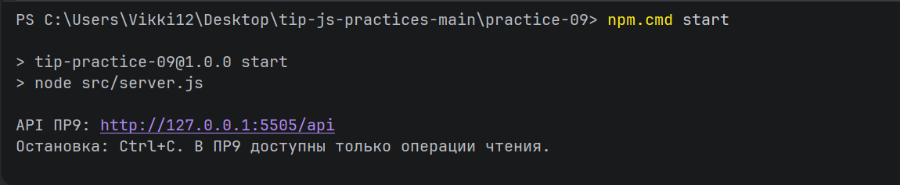

<figcaption>

Рисунок 1 — запуск собственного API на порту 5505.

</figcaption>
</figure>
<figure>

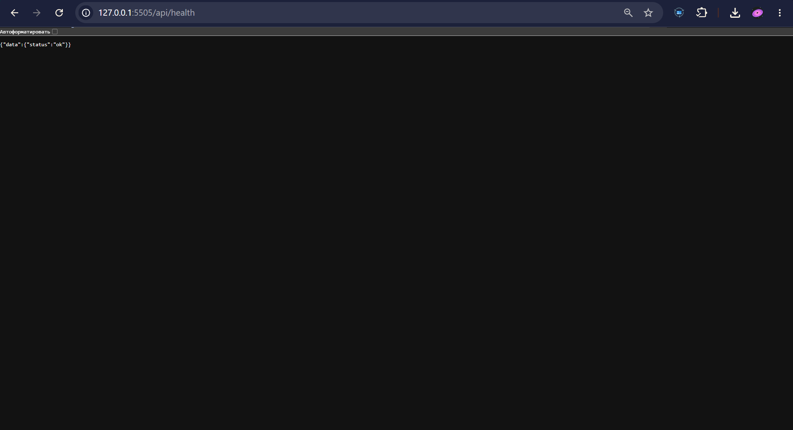

<figcaption>

Рисунок 2 — успешная проверка GET /api/health, статус 200 OK.

</figcaption>
</figure>

## 3. Структура проекта и назначение модулей

В соответствии с заданием основная реализация распределена между
отдельными модулями.

| Файл                  | Назначение                                                                                        |
|:----------------------|:--------------------------------------------------------------------------------------------------|
| `src/server.js`       | Проверяет порт и запускает Express-сервер.                                                        |
| `src/app.js`          | Создаёт приложение, подключает общие заголовки, CORS, Router, обработчик 404 и обработчик ошибок. |
| `src/data.js`         | Содержит исходные 12 задач и 3 категории.                                                         |
| `src/store.js`        | Создаёт независимые копии данных для экземпляра приложения и предоставляет методы чтения.         |
| `src/validation.js`   | Проверяет идентификаторы и query-параметры, возвращает нормализованные фильтры.                   |
| `src/task-service.js` | Выполняет фильтрацию и поиск задач без изменения исходного массива.                               |
| `src/routes.js`       | Связывает HTTP-маршруты с хранилищем и формирует ответы API.                                      |
| `src/errors.js`       | Содержит класс `ApiError` и единый обработчик ошибок.                                             |
| `checks/unit.test.js` | Модульные тесты функций проверки и фильтрации.                                                    |
| `checks/api.test.js`  | HTTP-тесты Express-приложения.                                                                    |
| `examples/books.js`   | Отдельный учебный пример маршрутизации Express.                                                   |

Маршруты получают данные через переданный `store`, а не импортируют
исходный массив напрямую. Функция `createApp()` создаёт приложение без
открытия постоянного порта, благодаря чему его можно использовать в
автоматических тестах.

<figure>

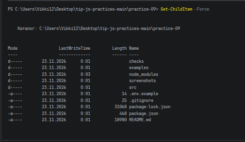

<figcaption>

Рисунок 3 — структура папки практической работы.

</figcaption>
</figure>

## 4. Реализованный контракт API

### 4.1. Маршруты

| Метод и путь             | Успешный статус | Результат                                       |
|:-------------------------|----------------:|:------------------------------------------------|
| `GET /api/health`        |             200 | `{ data: { status: "ok" } }`                    |
| `GET /api/categories`    |             200 | Список трёх категорий и `meta.total`            |
| `GET /api/tasks`         |             200 | Список задач и `meta` с количеством и фильтрами |
| `GET /api/tasks/:id`     |             200 | Одна задача в поле `data`                       |
| `HEAD` для GET-маршрутов |       Как у GET | Заголовки без тела ответа                       |
| `OPTIONS`                |             204 | CORS-заголовки без тела ответа                  |

Объект категории содержит поля `{ id, name }`. Объект задачи содержит
поля `{ id, title, completed, priority, categoryId }`.

Идентификаторы задач не совпадают с индексами массива: записи имеют
разреженные id от 1 до 34. Поэтому задача с id 4 ищется по полю `id`, а
не по позиции в массиве.

`meta.total` показывает количество элементов после применения фильтров.
Без фильтров список содержит 12 задач, список категорий — 3 записи. Если
совпадений нет, сервер возвращает `200 OK` и пустой массив `data`, а не
404.

<figure>

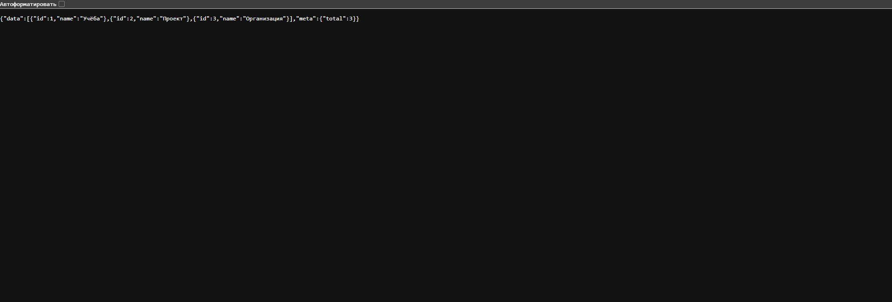

<figcaption>

Рисунок 4 — получение списка категорий.

</figcaption>
</figure>
<figure>

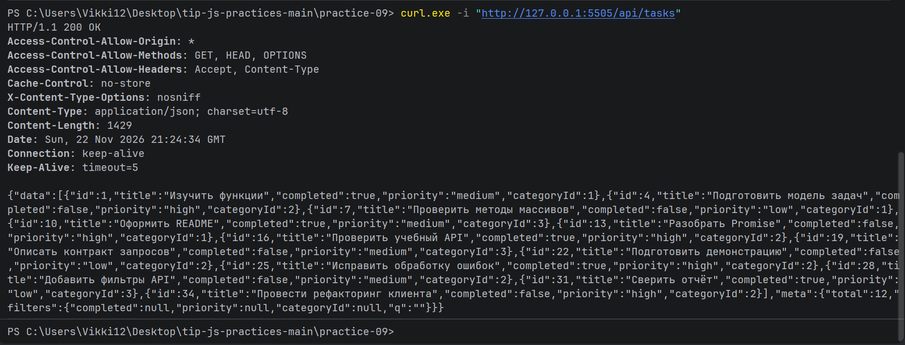

<figcaption>

Рисунок 5 — получение исходного списка задач без фильтров.

</figcaption>
</figure>

### 4.2. Query-параметры списка задач

Для `GET /api/tasks` реализованы следующие параметры:

| Параметр     | Допустимые значения                                       | Значение по умолчанию |
|:-------------|:----------------------------------------------------------|:----------------------|
| `completed`  | Только строки `true` или `false`, преобразуемые в boolean | `null`                |
| `priority`   | `low`, `medium`, `high`                                   | `null`                |
| `categoryId` | Положительное безопасное целое без ведущих нулей          | `null`                |
| `q`          | Строка после `trim`, длина не более 100 символов          | `""`                  |

Правила обработки параметров:

- неизвестные имена параметров отклоняются;
- повторение любого параметра отклоняется, даже если значения
  одинаковые;
- имена параметров чувствительны к регистру;
- пустые `completed=`, `priority=` и `categoryId=` недопустимы;
- пустой `q=` допустим;
- длина `q` проверяется после удаления пробелов по краям;
- все заданные фильтры применяются одновременно по логике **И**;
- поиск выполняется по вхождению текста в `title` без учёта регистра с
  использованием `toLocaleLowerCase('ru-RU')`.

Пример комбинированного запроса:

``` text
GET /api/tasks?completed=false&priority=high&categoryId=2
```

Фактически возвращаются задачи с id `4` и `34`, а `meta.total` равен
`2`.

<figure>

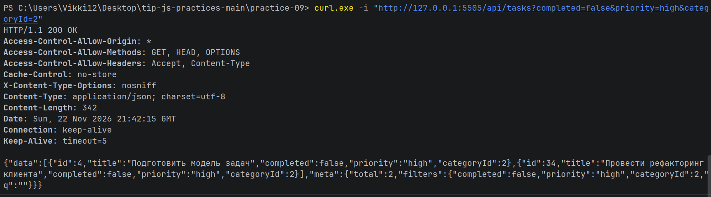

<figcaption>

Рисунок 6 — одновременное применение фильтров completed, priority и
categoryId.

</figcaption>
</figure>

### 4.3. Проверка идентификатора

Функция `parsePositiveId(raw)` принимает только строку, полностью
соответствующую регулярному выражению `/^[1-9]\d*$/`. После
преобразования дополнительно выполняется проверка
`Number.isSafeInteger`.

Отклоняются значения `0`, `-1`, `01`, `1.5`, `1e2`, `4abc`, строки с
пробелами и числа за пределами безопасного диапазона целых чисел.

Использования одного `parseInt` недостаточно: например,
`parseInt('4abc')` вернул бы число `4`, хотя весь идентификатор
некорректен.

### 4.4. Формат ошибок

Ошибки возвращаются в едином JSON-формате:

``` json
{
  "error": {
    "code": "TASK_NOT_FOUND",
    "message": "Задача не найдена.",
    "details": {
      "id": 2
    }
  }
}
```

| Условие                                    | HTTP-статус | Код                  |
|:-------------------------------------------|------------:|:---------------------|
| Некорректный query списка                  |         400 | `INVALID_QUERY`      |
| Некорректный id                            |         400 | `INVALID_ID`         |
| Корректный id отсутствует                  |         404 | `TASK_NOT_FOUND`     |
| Неизвестный маршрут                        |         404 | `ROUTE_NOT_FOUND`    |
| Неподдерживаемый метод известного маршрута |         405 | `METHOD_NOT_ALLOWED` |
| Неожиданная внутренняя ошибка              |         500 | `INTERNAL_ERROR`     |

Для `TASK_NOT_FOUND` возвращается `details: { id }`. Стек и внутренние
данные исключения клиенту не передаются. Для известных маршрутов при
статусе 405 установлен заголовок `Allow: GET, HEAD, OPTIONS`. Общие
ответы содержат `Cache-Control: no-store` и CORS-заголовки.

<figure>

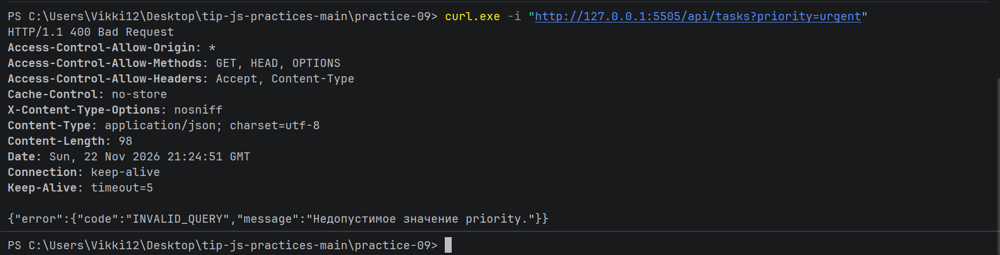

<figcaption>

Рисунок 7 — некорректный priority возвращает 400 INVALID_QUERY.

</figcaption>
</figure>
<figure>

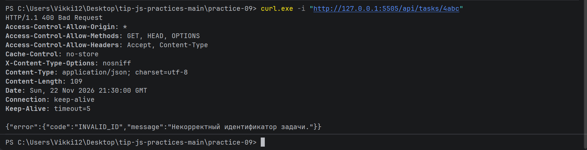

<figcaption>

Рисунок 8 — некорректный id 4abc отклоняется с ответом 400 INVALID_ID.

</figcaption>
</figure>

## 5. Выполнение индивидуального варианта № 3

Для варианта №3 основной фильтр — задачи с высоким приоритетом:

``` text
GET /api/tasks?priority=high
```

Ожидаемые и полученные идентификаторы:

``` text
4, 13, 16, 25, 34
```

Количество элементов `meta.total` равно `5`.

Нормализованный объект фильтров:

``` json
{
  "completed": null,
  "priority": "high",
  "categoryId": null,
  "q": ""
}
```

Отрицательный сценарий:

``` text
GET /api/tasks?priority=urgent
```

Фактический результат — `400 Bad Request`, код `INVALID_QUERY`,
поскольку `urgent` не входит в список допустимых значений приоритета.

Дополнительные запросы варианта:

| Запрос             | Фактический результат                                         |
|:-------------------|:--------------------------------------------------------------|
| `GET /api/tasks/4` | `200 OK`, возвращена задача «Подготовить модель задач» с id 4 |
| `GET /api/tasks/2` | `404 Not Found`, `TASK_NOT_FOUND`, `details.id = 2`           |

<figure>

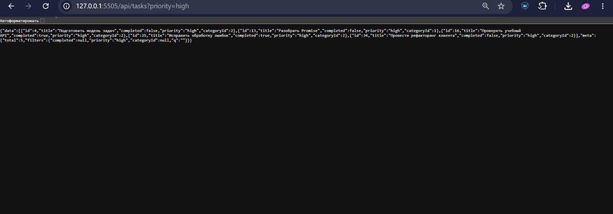

<figcaption>

Рисунок 9 — результат индивидуального варианта №3: пять задач с высоким
приоритетом.

</figcaption>
</figure>
<figure>

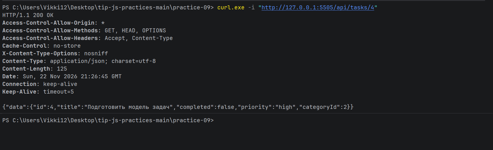

<figcaption>

Рисунок 10 — получение отдельной задачи по идентификатору 4.

</figcaption>
</figure>
<figure>

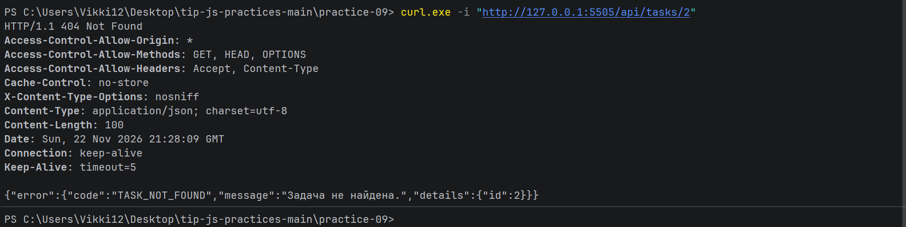

<figcaption>

Рисунок 11 — для отсутствующей задачи возвращается 404 TASK_NOT_FOUND.

</figcaption>
</figure>

## 6. Автоматические проверки

В проекте предусмотрено 90 автоматических проверок:

- 38 модульных проверок;
- 52 HTTP-проверки.

Команды запуска из папки `practice-09`:

``` powershell
npm.cmd run check:unit
npm.cmd run check:api
npm.cmd test
```

Результаты сохранённого запуска:

| Набор проверок            | Успешно | Ошибок |
|:--------------------------|--------:|-------:|
| Модульные (`check:unit`)  |      38 |      0 |
| HTTP (`check:api`)        |      52 |      0 |
| Общий запуск (`npm test`) |  **90** |  **0** |

Модульные тесты проверяют разбор параметров, границы чисел и строк,
фильтры, отсутствие мутации исходных данных и работу с другими
массивами.

HTTP-тесты проверяют реальные ответы Express-приложения: статусы, JSON,
фильтрацию, HEAD, OPTIONS, заголовок Allow, общие заголовки, неизвестные
маршруты и обработку неожиданных исключений.

**Итог сохранённого прогона:** `tests 90`, `pass 90`, `fail 0`. Как
указано в разделе 2, этот прогон был зафиксирован на Node.js 26.13.0.
После переключения на требуемую Node.js 24.x необходимо повторить
`npm.cmd ci` и `npm.cmd test`.

<figure>

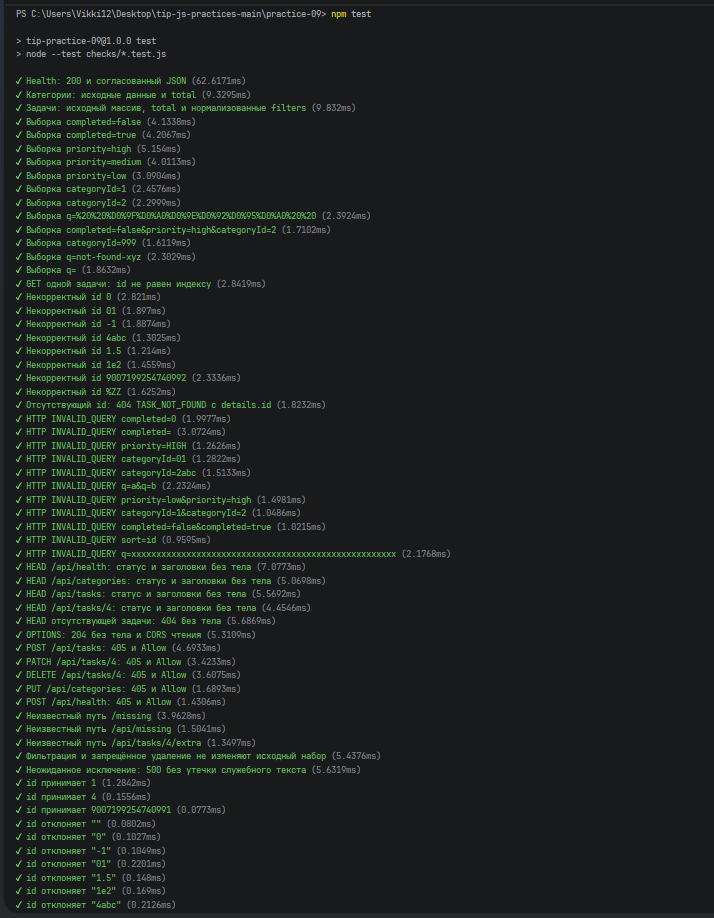

<figcaption>

Рисунок 12 — выполнение автоматических тестов.

</figcaption>
</figure>
<figure>

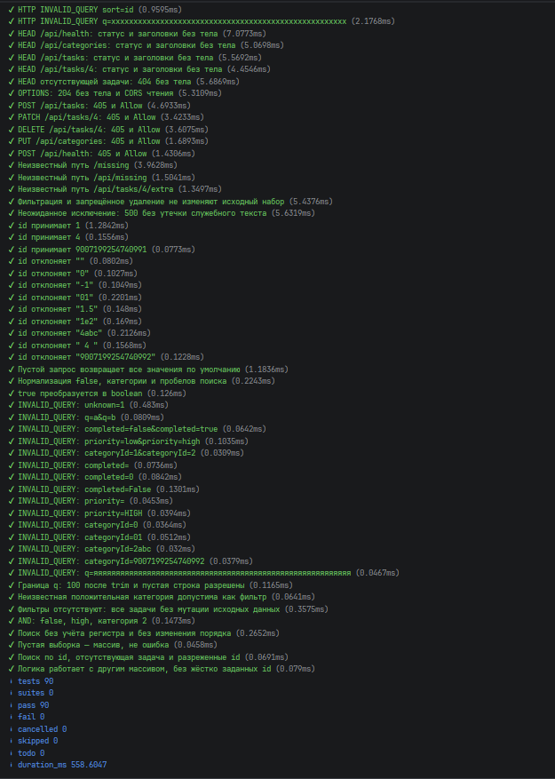

<figcaption>

Рисунок 13 — итог: 90 проверок пройдено, ошибок нет.

</figcaption>
</figure>

## 7. Фактический ручной HTTP-протокол

Запросы выполнялись в PowerShell через `curl.exe`. URL с символом `&`
заключались в кавычки.

|   № | Проверка                               | Фактический результат                                                                           |
|----:|:---------------------------------------|:------------------------------------------------------------------------------------------------|
|   1 | `GET /api/health`                      | `200 OK`, статус `ok`                                                                           |
|   2 | `GET /api/categories`                  | `200 OK`, три категории, `meta.total: 3`                                                        |
|   3 | `GET /api/tasks`                       | `200 OK`, 12 задач, `meta.total: 12`                                                            |
|   4 | `GET /api/tasks?priority=high`         | `200 OK`, id 4, 13, 16, 25, 34; `meta.total: 5`                                                 |
|   5 | `GET /api/tasks?q=not-found-xyz`       | `200 OK`, пустой `data`, `meta.total: 0`                                                        |
|   6 | `GET /api/tasks/4`                     | `200 OK`, возвращена задача с id 4                                                              |
|   7 | `GET /api/tasks/2` и `/api/tasks/4abc` | `404 TASK_NOT_FOUND` и `400 INVALID_ID` соответственно                                          |
|   8 | Неизвестный или повторяющийся query    | `400 INVALID_QUERY`; проверены неизвестный `sort` и повторения параметров                       |
|   9 | `POST /api/tasks`                      | `405 METHOD_NOT_ALLOWED`, `Allow: GET, HEAD, OPTIONS`; PATCH, DELETE и PUT также возвращают 405 |
|  10 | `GET /api/unknown`                     | `404 ROUTE_NOT_FOUND`, JSON-ответ                                                               |
|  11 | `HEAD /api/tasks`                      | `200 OK`, заголовки присутствуют, тело отсутствует                                              |
|  12 | `OPTIONS /api/tasks`                   | `204 No Content`, CORS-заголовки, тело отсутствует                                              |
|  13 | Остановка и повторный запуск сервера   | После перезапуска health и список задач снова доступны; исходные 12 задач сохранены             |

Дополнительно проверены:

- `completed=false` и комбинированный фильтр
  `completed=false&priority=high&categoryId=2`;
- поиск `promise`, `PROMISE`, поиск с пробелами по краям и строка только
  из пробелов;
- длина `q` ровно 100 символов и превышение ограничения;
- повторяющиеся параметры `q`, `priority`, `categoryId`, `completed`;
- некорректные значения `completed`, `priority`, `categoryId`;
- `categoryId=0`, отрицательное значение, десятичная дробь,
  экспоненциальная запись, ведущий ноль, буквенный суффикс и число вне
  безопасного диапазона;
- корректный положительный, но отсутствующий `categoryId=999`, который
  возвращает пустую выборку со статусом 200.

<figure>

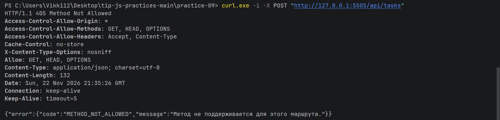

<figcaption>

Рисунок 14 — неподдерживаемый POST возвращает 405 и заголовок Allow.

</figcaption>
</figure>
<figure>

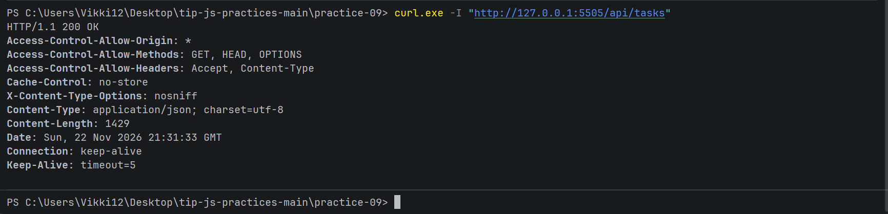

<figcaption>

Рисунок 15 — HEAD возвращает заголовки без тела ответа.

</figcaption>
</figure>
<figure>

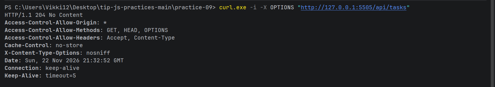

<figcaption>

Рисунок 16 — OPTIONS возвращает 204 и CORS-заголовки.

</figcaption>
</figure>

## 8. Обнаруженный и исправленный дефект

При обработке `completed=false` нельзя использовать обычное
преобразование `Boolean(raw)`. В JavaScript выражение `Boolean('false')`
возвращает `true`, потому что непустая строка считается истинным
значением.

Исправление выполнено в два этапа:

1.  В `parseFilters` разрешаются только точные строки `'true'` и
    `'false'`.
2.  После проверки значение преобразуется выражением
    `completed = raw === 'true'`.

В `selectTasks` проверка выполняется через `filters.completed !== null`.
Благодаря этому значение `false` не воспринимается как отсутствие
фильтра.

Дополнительно строгая проверка id не позволяет принять `4abc` как
идентификатор `4`, а `Number.isSafeInteger` отклоняет числа за пределами
безопасного диапазона.

## 9. Ответы на контрольные вопросы

**1. Чем JavaScript в Node.js отличается от JavaScript в браузере?**  
Node.js исполняет JavaScript вне браузера и предоставляет серверные API.
В нём нет DOM, `window` и `localStorage`.

**2. Что определяет выбор маршрута: путь, query или HTTP-метод?**  
Маршрут выбирается по HTTP-методу и пути. Query-параметры не входят в
путь и обрабатываются внутри обработчика.

**3. Чем `req.params` отличается от query-параметров?**  
`req.params` содержит значения динамических частей пути, например `:id`.
Query-параметры находятся после `?` в URL.

**4. Почему строка `'false'` требует явного преобразования?**  
Это непустая строка, поэтому `Boolean('false')` возвращает `true`. Нужно
сначала проверить точное значение, а затем преобразовать его в boolean.

**5. Зачем проверять весь id и `Number.isSafeInteger`?**  
Проверка всей строки не позволяет принять лишние символы, а
`Number.isSafeInteger` исключает числа, которые JavaScript не может
точно представить.

**6. Почему пустая выборка имеет статус 200, а отсутствующая задача —
404?**  
Пустая выборка является корректным результатом запроса списка. Статус
404 означает, что конкретная запрошенная задача не найдена.

**7. В чём различие `TASK_NOT_FOUND` и `ROUTE_NOT_FOUND`?**  
`TASK_NOT_FOUND` означает, что маршрут существует, но задачи с указанным
id нет. `ROUTE_NOT_FOUND` означает, что неизвестен сам путь.

**8. Чем 405 отличается от 404 и зачем нужен `Allow`?**  
405 означает, что путь известен, но HTTP-метод не поддерживается. 404
означает, что маршрут не найден. Заголовок `Allow` перечисляет
разрешённые методы.

**9. Что означает `meta.total` при активных фильтрах?**  
Это количество записей после применения фильтров, а не размер всего
исходного хранилища.

**10. Как порядок middleware влияет на результат?**  
Express передаёт управление обработчикам в порядке их регистрации.
Поэтому сначала подключаются общие middleware и маршруты, затем 404 и
обработчик ошибок.

**11. Почему обработчик ошибок имеет четыре параметра?**  
Сигнатура `(error, req, res, next)` позволяет Express распознать функцию
как middleware обработки ошибок.

**12. Зачем фабрика приложения отделена от открытия порта?**  
`createApp()` можно использовать в тестах без запуска постоянного
сервера. Открытие порта выполняется отдельно в `server.js`.

**13. Какие данные допустимо отправлять клиенту при внутренней
ошибке?**  
Клиенту отправляется безопасный код `INTERNAL_ERROR` и понятное
сообщение. Стек и внутренние данные исключения не раскрываются.

**14. Почему CORS не является авторизацией?**  
CORS регулирует доступ браузерного JavaScript к ответу, но не проверяет
личность пользователя и не заменяет авторизацию.

**15. Какие изменения потребуются в ПР10 для подключения всех действий
клиента ПР8?**  
Потребуется добавить операции создания, редактирования и удаления задач,
проверку тела запроса и интеграцию React-клиента с полным API.

## 10. Вывод

В ходе практической работы №9 создан собственный HTTP API на Node.js и
Express. Реализованы маршруты чтения состояния сервиса, категорий,
списка задач и отдельной задачи. Добавлены проверка идентификаторов и
query-параметров, фильтрация по нескольким условиям, поиск по названию,
единый формат ошибок, обработка методов HEAD и OPTIONS и CORS-заголовки.

Проверены успешные ответы, некорректные параметры, отсутствующие задачи,
неизвестные маршруты и неподдерживаемые методы. Индивидуальный вариант
№3 выполнен: фильтр `priority=high` возвращает пять задач с id 4, 13,
16, 25 и 34.

По сохранённому запуску успешно завершены все 90 автоматических
проверок: 38 модульных и 52 HTTP, ошибок нет. Для полного соответствия
требованию по среде необходимо повторить тесты после переключения
локальной установки на Node.js 24.x.

## 11. Состав скриншотов

В папке `screenshots/` находятся 43 снимка фактических проверок API:
запуск сервера, health, категории, список задач, индивидуальный вариант,
фильтры, граничные значения, ошибки, HTTP-методы, перезапуск сервера,
структура проекта и итог автоматических тестов.

В этот отчёт вставлены основные иллюстрации. Остальные снимки оставлены
в папке `screenshots/`, чтобы не перегружать документ повторяющимися
изображениями. **90 автоматических проверок не требуют 90 отдельных
скриншотов**: их общий результат подтверждается выводом `npm test`.


